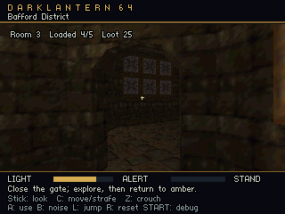
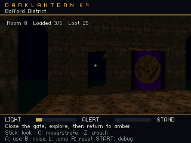
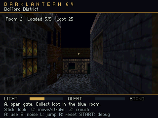

# Bafford transition performance acceptance

The district's ordinary correctness tour uses fixed diagnostic time and waits
for a ready working set at checkpoints. It proves floors, door/loot persistence,
retirement and restart. It cannot establish uninterrupted wall-time simulation
or imperceptible loading. The separate performance variant follows the same 41
checkpoints at ordinary walking speed using actual CP0 elapsed time. It removes
intermediate readiness waits and the twelve-frame waypoint dwell. Initial start
and remote restart admission remain explicit and are reported separately.

```powershell
python tools/build.py --bundle content/level_bundle.json --bafford-district-performance-test
python tools/verify_bafford_district_performance.py --rom build/DarkLantern64-bundle-level_bundle-menu-bafford-district-test-performance-t3d.z64 --output build/bafford-district-performance.json
```

The verifier requires every gameplay frame and raw frame interval to stay at or
below 33.333333 ms, every stream service CPU sample at or below 8 ms, and no
dropped simulation time. Service elapsed and render elapsed have their own
33.333333 ms maxima. Percentiles describe the workload; they never waive a rare
failure. `--frame-budget-ms 32` can impose a stricter maximum. Loading input
filtering must suppress zero requested movement/jump ticks, and authored
interactions must incur zero loading waits. The report records consecutive
blocked episodes, maximum episode duration, per-frame blocked ticks, actual
interaction waits, heap headroom, music underruns and service stages. A smooth
frame which freezes movement at a loading gate fails acceptance.
Render frames with no simulation step between blocked ticks remain in the same
blocked episode; a stopped actor does not become a new episode merely because
the accumulator waits for another fixed tick. Audio or functional acceptance
failure preserves the independent timing report and fails overall acceptance.

Checkpoints record both the published view and physical resident chunks. The
verifier compares published geometry/collision resources with exact cooked
working cases and requires the current conservative visible set to be ready.
It independently checks physical residency, bounded reservation, actual home
retirement/reload, door/loot state, two physical stair jumps, both launch epochs,
and music continuity. Background preparation may continue while walking through
an already published region. It does not excuse missing current visibility.

The current measurement contract is `stream_perf_config version=2`, `dt=wall`,
`route=continuous`. Each `stream_perf_frame` contains a contiguous sequence,
launch epoch and fifteen hexadecimal values in this order:

| Index | Sample |
| --- | --- |
| 0 | Whole gameplay frame elapsed ticks |
| 1 | Raw interval submitted to simulation |
| 2 | Stream service elapsed ticks |
| 3 | Stream service ticks excluding audio callbacks |
| 4 | Renderer call elapsed ticks |
| 5 | Actual simulation input duration in ticks |
| 6–7 | Simulation tick count before and after advance |
| 8 | Remaining simulation accumulator ticks |
| 9 | Cumulative dropped ticks in this launch epoch |
| 10 | Last service stage: idle/read 0, assembly 1, GPU preparation 2, publication 3 |
| 11–12 | Physical resident mask and measured heap usage |
| 13 | Requested movement/jump ticks suppressed by stream filtering |
| 14 | Route wait flags: admission 1, loading interaction 2, unapplied interaction 4 |

The parser conserves accumulator, input time, executed ticks and explicit
dropped time across every frame. It rejects missing/repeated records,
unexpected epoch resets, mismatching route tick counts, admission waits during
the active route, and frames after the unique performance completion. Logging
overhead remains in the following raw frame interval. Render elapsed includes
display/queue waits and does not directly measure RSP/RDP execution.

## Implementation under measurement

Night stream missions now cook DLR1 v4 offline. The native host worker runs the
shared C lighting kernel on the serialized region-local float vertices and
snorm8 normals, against the complete authored mission's colliders, exact floors
and global lights. Each static triangle carries front/back RGBA for closed and
open door states. Eligible shared bootstrap visuals have per-instance constant
color arrays. Unavailable-region movement barriers are excluded from this
offline shadow scene, so static shadows do not change merely because a neighbor
retires. Moving actors and other live-lighting cases retain their runtime path.
The format and cache inputs are specified in
[the mission package reference](mission-package-format.md).

The runtime copies those colors into fixed scene banks and consumes them during
rendering. It does not retrace static vertex shadows while preparing the
district's next working set. Embedded triangle colors are already part of
mission ROM bytes; bootstrap constant colors are counted separately as resident
arrays. The DLS1 host worker cache, including its table/header, is not a separate
ROM asset.

Transition preparation keeps the published scene available while assembling a
candidate bank. Work advances through chunk reads/checksums, bounded scene
assembly, collision-index construction, staged Tiny3D preparation and
publication. Scene assembly and GPU preparation use tick-budgeted service
slices; packing, buffer copies and command creation are split into smaller jobs.
The accepted configuration uses 5.5 ms assembly/GPU slices and 8 KiB ROM reads
through an 8,208-byte independent DMA staging allocation. Read processing is
admitted only while the service call has spent less than 4 ms. These are work
slices rather than acceptance waivers: the complete service CPU and gameplay
frame must still meet their measured maxima.
The current/candidate resource union is bounded by the authored slot, model and
vertex limits. Physical chunk residency alone does not make a candidate safe to
cross into: its geometry, collision index and render resources must be published.

The final bridge reads chunks in bounded 8 KiB slices through an independent
aligned PI staging buffer. CPU assembly and GPU packing each
target 5.5 ms per frame; additional IO starts only while service elapsed time
is below 4 ms. These are scheduling targets, not maximum guarantees for an
individual non-preemptible job: the strict measured limits still apply. A 5 m
direction-aware approach selects one outgoing transition union, with reversal
hysteresis to avoid cancelling useful work because of tiny contact corrections.

Stable region/material/attribute identities let unchanged streamed groups reuse
CPU model bounds and packed Tiny3D resources across bank swaps. Newly needed
resources are prepared alongside the current view; retired resources wait for
their graphics ownership to finish. A changed approach can cancel an unpublished
candidate rather than completing work for an obsolete doorway. Active guard
membership is rechecked before publication. These mechanisms preserve the
mission-owned door, loot and actor state when a region departs or returns.

Each bank builds a bounded spatial hierarchy for box/floor query candidates and
caches box rotations and exact floor arithmetic. Movement, support and sight
queries still apply their original narrow tests in original contact order.
Conservative candidate bounds include rounding margins; incomplete or mismatched
indexes use the scalar path. A complete matching index is required before a
stream candidate is published. This reduces repeated gameplay work without
replacing sloped floors or filling openings with approximate solids.

Initial admission and remote restart may synchronously establish their starting
view before gameplay is admitted. Their duration must be reported separately
from ordinary gameplay frames and gate crossings. Background work during play
must satisfy the measured frame/service budgets, preserve simulation time and
avoid movement or interaction waits at gates. Small preparation slices, cached
lighting or a passing frame-time run alone do not establish imperceptible
loading. The final recorded Ares tour passes the functional, timing, simulation,
current-visibility, zero-gate-wait and audio checks together. This result covers
the measured route and build; original hardware and additional routes remain
unverified by this performance run.

For manual changes to the working sets and doorway cuts being measured, see
[the content authoring guide](bafford-content-authoring.md). A valid cook checks
capacities; it does not prove that a newly opened sightline has a complete view.

## Accepted continuous tour

The [final evidence](evidence/stream-performance-final.json) records ROM SHA-256
`570f679a1f60639b334a50b676fc9bd5d897305868f28fcd6b3e67d9a4c3cb89`,
mission SHA-256
`7e7243182bc47d4090d117596438fdd1c5c4dfae3faede6714407c90ac0f87c9`,
and the immutable log in
`.dev/ares/runs/9dc85ef9d9864a4a9ff6e7d56ceadb01/bafford-district-performance.log`.
All 41 checkpoints pass across nine visited regions and two launch epochs,
including physical stair jumps, door use, loot retirement/reload and restart.
The route completes 32 region loads and 27 retirements before restart.

| Final measurement | Result | Required maximum |
| --- | ---: | ---: |
| Gameplay frame samples | 3,458 | Every sample checked |
| Maximum gameplay frame | 31.623083 ms | 33.333333 ms |
| Maximum raw simulation interval | 30.839189 ms | 33.333333 ms |
| Maximum stream service CPU | 7.528064 ms | 8 ms |
| Maximum stream service elapsed | 9.161877 ms | 33.333333 ms |
| Maximum render call elapsed | 19.133504 ms | 33.333333 ms |
| Gameplay frame p99 | 22.228821 ms | Descriptive only |
| Executed simulation ticks | 3,479 | Every frame conserved |
| Dropped simulation ticks / duration mismatches | 0 / 0 | 0 |
| Loading-suppressed movement/jump ticks | 0 | 0 |
| Loading interaction waits / unapplied interaction frames | 0 / 0 | 0 |
| Music underruns | 0 | 0 |
| Peak sampled heap | 2,059,600 bytes | Measured separately |
| Reported heap headroom | 5,160,048 bytes | Sampled, not a full memory ledger |

Music continuity covers 1,810,056 consumed frames and 1,427 generated blocks
over 61 diagnostic observations. Initial/restart admission occupies 178 recorded
frames and remains separate from walking: there are no intermediate readiness
holds or waypoint dwell frames. Initial renderer preparation takes 74.365333 ms;
restart renderer preparation takes 75.199701 ms. Those figures measure renderer
preparation, not the complete cold-start admission duration.

The source geometry and authored policy were retained during the performance
work: ten regions, 2,537 static triangles, 603 boxes and 118 exact floor triangles.
The cooker validates 49 stable, transition-union and partial publication cases.
Working budgets remain five region slots, 1,440 static triangles, 64 groups,
128 floors and 400 combined boxes/floors/gate barriers. The largest cooked
witnesses use 1,322 triangles and 383 combined contacts. Performance was achieved
through cooking, bounded preparation and query/resource reuse while retaining
the authored visible sets.

DLR1 v4 adds 48 bytes of two-state front/back RGBA per static triangle, increasing
the district package from 245,496 to 367,272 bytes: 121,776 added bytes already
included in the package. The 1,152 bootstrap color bytes are separate resident
constant arrays. No standalone lighting ROM asset is added. Five region slots
occupy 273,680 bytes at the largest-chunk allocation size; directory, DMA, scene,
renderer and audio allocations are additional. This storage cost is explicit
and does not increase the working-set geometry/contact budgets.

The [integration ledger](evidence/stream-performance-integration.json) binds the
normal menu ROM and all diagnostic variants to the same cooked mission and
unchanged source/partition hashes. Separate [ordinary tour](evidence/stream-performance-ordinary.json),
[capture tour](evidence/stream-performance-capture.json), [menu lifecycle](evidence/stream-performance-menu.json),
[legacy probe](evidence/stream-performance-probe.json) and [legacy street](evidence/stream-performance-street.json)
checks pass. Menu verification covers all eight levels and 31 default/named
starts, three launch/restart cycles, resumes, stable per-start heaps, direct
starts and the 4 MiB boot rejection. Capture exports are excluded from ordinary
audio/timing acceptance because export adds diagnostic audio cost.

The [live editor checks](evidence/stream-performance-editor.json) exercise paired
visibility/gate history, floor editing, source publication and explicit Native
Play gating; the [saved cook panel check](evidence/stream-performance-editor-cook.json)
verifies v4 source/manifest binding and nonduplicated memory categories. All
portable C groups and the editor's two native tests pass. The broad Python run
has 474 passes, two skips and the existing local Sponza parapet geometry/collider
mismatch among 477 tests; it is not an all-green suite.

Final ROM framebuffer views, inspected separately from timing acceptance:

| Main interior | Rear courtyard | Eastern interior |
| --- | --- | --- |
|  |  |  |

## Comparing preparation costs

The historical renderer blocked gameplay while doing its complete lighting and
packing work. In the final build, the `scene_load` measurement is the last
publication/commit call after earlier preparation. Its 33 transition calls total
158.486400 ms, with a 7.572843 ms maximum. Comparing that total alone with the
old 292.526 seconds would omit the distributed work.

Across the final tour, service frames tagged assembly, GPU preparation and
publication spend 2.914786 seconds in total elapsed service work, or 2.833465
seconds with audio callback time removed. The same tagged frames account for
10.176064 seconds of cumulative raw route intervals, in 35 contiguous groups
including two cancelled candidates; the largest group accounts for 472.056512 ms.
Gameplay continues through these intervals. These sums are derived from the
same hashed log, exclude preceding idle/read-stage frames, and are not direct
job-duration or complete request-to-publication measurements.
Read-stage timing combines idle service and ROM/checksum work, so it cannot be
presented as isolated IO cost. The remaining acceptance evidence is direct:
every measured frame fits its budget, simulation time is conserved, and the
actor reaches every tested gate without loading suppression or interaction wait.

## Historical baseline

The immutable baseline log is
`.dev/ares/runs/629e5e3cfbae4fabbb3519dc2b057af9/bafford-district.log`.
Its ROM SHA-256 is
`a3853764ae08cae5f8c43e221dc32f71b99cb04e319527159bc4b23fb673d89e`.
It passed all 41 functional checkpoints with zero music underruns, but lacked
wall-time simulation instrumentation. The baseline analysis deliberately marks
performance acceptance false.

| Historical measurement | Result |
| --- | ---: |
| Initial renderer preparation | 4.250 s |
| Remote restart renderer preparation | 4.249 s |
| Transition renderer preparations | 42 |
| Total transition renderer preparation | 292.526 s |
| Maximum transition preparation | 15.702 s |
| Transition preparation spent lighting | 97.46% |
| GPU preparation range | 60.741–168.791 ms |
| Exact profiled frame samples | 7,833 |
| Maximum profiled frame | 15.798 s |
| Profiled frames above 33.333333 ms | 46 |
| Profiled frame p99 | 28.598 ms |

Initial renderer preparation falls from 4.250 seconds to 74.365333 ms, and the
remote restart renderer preparation falls from 4.249 seconds to 75.199701 ms.
The largest gameplay-frame measurement falls from 15.798 seconds in the fixed
baseline profile to 31.623083 ms in the continuous wall-time tour. The baseline
has 46 frames above budget; the final tour has zero. The historical fixed-time
route and final continuous route differ in frame and preparation counts, so
these comparisons describe measured behavior rather than equal-work benchmarks.

The p99 falls below budget despite repeated multi-second pauses. This is why
acceptance gates every sample and its maximum. Initial/restart costs must not be
reported as the total transition cost: all 44 renderer preparations totaled
301.025 s. The fixed-time baseline cannot measure lost wall-time simulation.

```powershell
python tools/verify_bafford_district_performance.py --baseline --log .dev/ares/runs/629e5e3cfbae4fabbb3519dc2b057af9/bafford-district.log --output build/stream-performance-baseline.json
```

The [baseline evidence](evidence/stream-performance-baseline.json) preserves the
input identities and measurements. Ares reports emulated target elapsed time;
original N64/M64 performance and presentation remain unverified. Captures are
excluded from this acceptance check.
