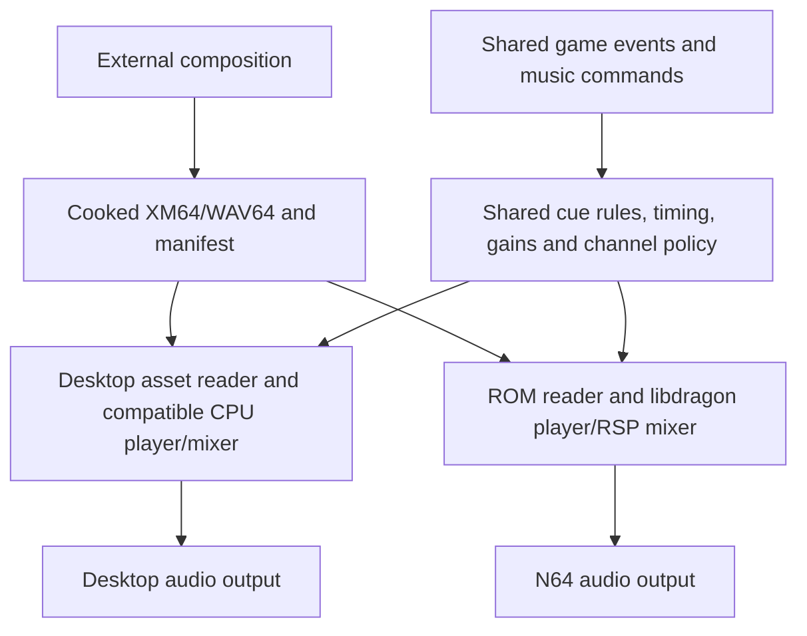

# Music

Status: first Sponza XM64 integration implemented and verified in Ares, 2026-09-08. **Sponza now plays Lanterns Below in the game ROM.** The broader authoring/editor design remains proposed. Proposed budgets and limits below are evaluation targets, not accepted allocations or tested console capabilities.

The original [48-second music study, Lanterns Below](music-study.md), provides editable XM/sample sources, verified cooked-file host rendering, a WAV64 alternative, and a standalone audition ROM. Its XM64 cue is now assigned to Sponza. Native editor Play audio remains to be connected.

## Play the implemented Sponza cue

```powershell
python tools/build.py --level content/sponza_courtyard.json --run
```

[content/music.json](../content/music.json) assigns cues by canonical level filename stem. The build converts the saved XM with the installed `audioconv64`, caches by source/converter identity, and packages the result into DragonFS. Sponza plays it in direct builds and when selected from the ordinary bundle. Its gain is 0.55 so gameplay effects retain space. Other levels currently have no music assignment. Editing the XM and rebuilding recooks the cue without regenerating the composition.

The first runtime keeps the four synthesized effect voices in the AI interrupt. [dl_music.c](../src/dl_music.c) runs the XM sequencer/RSP mixer on the foreground and publishes completed stereo PCM into a four-block queue. The interrupt consumes one completed block and combines it with the effects using bounded integer work. No file access, sequencing, allocation, or RSP submission runs in the interrupt. The inspected `mixer_poll` waits for its high-priority audio work; the integration does not add a full graphics-queue drain.

Music is stopped before level loading and restarted after the scene is ready. The level menu pauses consumption and production while retaining the queued music; resuming continues it. Restart or switching levels discards the old queue and establishes the new cue. Already submitted AI buffers can remain audible briefly. The persistent queue reserves 20,352 bytes at the measured 31,995 Hz / 1,272-frame configuration, about 159 ms of music prefetch before device buffering. This is an initial ambience policy, not a low-latency adaptive-score implementation. Mixer/queue allocations remain retained after stopping; include them in warmed memory budgets.

[The Sponza Ares check](evidence/sponza-music.json) consumed 1,576,008 music frames through the 48-second loop with zero software-queue underruns and nonzero PCM, alongside Tiny3D and two active guards. This was a stationary default-spawn test; it does not cover all camera positions, transitions, AI/device faults, or original hardware. The observed scene delivery was about 20.14 fps; no matching music-disabled baseline was taken, so this is not a graphics-regression comparison. CPU interrupt mixing remains in the profiler's `audio_mix` slot; foreground sequencing/mixing and its waits currently contribute to `other`. Cumulative `service_ticks` includes interrupts and RSP waits and is not pure CPU execution time.

## Recommendation and first step

Build a small **music playback study inside the game** before commissioning a soundtrack or building an editor sequencer. Compare an eight-channel XM tracker cue with a rendered stereo version of the same cue, cooked to WAV64. Play each alongside gameplay sounds in the guard workshop and Sponza. Measure memory, audio continuity, CPU/RSP cost, and frame delivery, then choose the default authoring route.

My starting recommendation is **XM64 for the reusable score, WAV64 for rendered textures or exceptions**. XM offers economical sample reuse and musical structure; a rendered track preserves a composer's external instruments and effects. The comparison can reverse this recommendation if the intended sound or composer workflow favors recordings. We can expose the same game-facing cue interface for either backend without implementing every backend immediately.

The first deliverable should be one 30–60-second loop, a separate short sting, a repeatable in-game audition, and a measured report. Full adaptive scoring, custom MIDI synthesis, and instrument-bank sharing come after this evidence.

## What exists today

| Area | Observed implementation |
| --- | --- |
| N64 sound output | [src/main.c](../src/main.c) requests 32,000 Hz with four output buffers, reads the actual rate, and primes an interrupt-driven output callback. |
| Audible sources | Four CPU-generated triangle/noise effect voices, with short envelopes and stereo gains. Objective notes are synthesized effects, not a music sequencer. |
| Music runtime | Eight-channel XM64 player with a completed-PCM queue and Sponza assignment; menu pause, level-entry restart, and per-cue gain. WAV64 remains in the standalone study. No layered/adaptive transition system. |
| Asset packaging | [tools/cook_music.py](../tools/cook_music.py) cooks assigned XM files into the bundle's DragonFS package. Music-only asset packages also enable filesystem initialization. |
| Memory planning | [Audio Memory](audio-memory-planning.md) estimates hypothetical audio scenarios. Its 256 KiB envelope and 16-slot pool are illustrative; they neither allocate RAM nor configure the runtime. |
| Profiling | [src/dl_profile.c](../src/dl_profile.c) measures the CPU audio callback. Music logs count generated/consumed blocks, software underruns, PCM peak and cumulative service time; separate CPU/RSP attribution remains pending. |
| Desktop iteration | Level build/launch workflows exist. There is no verified music import, target-format preview, or music reload workflow. |

The local libdragon checkout is at the inspected fork revision `7a82f8e50e82ad4601d530801630d8bd0d2fcd00`. Installed headers and converter help were inspected as well. [dependencies.json](../dependencies.json) explicitly says builds use the installed SDK rather than an automatically provisioned source pin; a future music cook must fingerprint the actual converter and runtime libraries.

## N64 provisions and limits

The audio interface reads **16-bit stereo sample frames from RDRAM** and feeds the DAC. Software creates that final mix, using the CPU and, ordinarily, RSP. There is no fixed onboard piano/string/drum bank and no hardware rule limiting a song to four instruments. The current four voices are our prototype's policy. [Nintendo audio architecture](https://ultra64.ca/files/documentation/online-manuals/man/kantan/step2/3-1.html)

The stock N64 has 4 MiB RDRAM; DarkLantern64 requires **8 MiB total** through the Expansion Pak baseline. Audio shares that memory with the entire game. Samples can live in cartridge ROM and stream into bounded RAM buffers, but ROM space, transfer bandwidth, decoding, and deadlines still matter. See the [accepted memory decision](decisions/0001-memory-baseline.md).

The installed libdragon mixer supports **up to 32 software mixer channels**, with RSP mixing, playback-rate changes, and left/right gain. A mono waveform uses one; a stereo waveform uses two adjacent channels. These are not 32 cost-free hardware synthesizers, and the game should reserve channels for audible gameplay. [Mixer API](https://libdragon.dev/ref/mixer_8h.html)

Output rate is configurable; 44.1 kHz is not a hard maximum. Begin the study at **32 kHz stereo**, then compare 44.1 kHz if high-frequency detail warrants its cost. Read `audio_get_frequency()` and `audio_get_buffer_length()` at runtime: clock dividers and driver alignment affect the actual rate and block length. The checked driver uses approximately 40 ms blocks. Buffer count alone does not select a shorter block duration. [Audio API](https://libdragon.dev/ref/audio_8h.html), [driver at the inspected revision](https://github.com/hughes/libdragon/blob/7a82f8e50e82ad4601d530801630d8bd0d2fcd00/src/audio.c)

The checked mixer resamples by point sampling. Wide pitch shifts can therefore sound different from a desktop tracker using a high-quality interpolator. Prepare samples at useful pitch ranges, audition the cooked result, and treat improved interpolation as separately profiled SDK work. RSP audio also competes with Tiny3D geometry; do not extrapolate a standalone audio demo's performance to our busiest scene. [Inspected mixer microcode](https://github.com/hughes/libdragon/blob/7a82f8e50e82ad4601d530801630d8bd0d2fcd00/src/audio/rsp_mixer.S)

## Playback choices and instruments

| Route | External source → target | Instruments and simultaneous playback | Tradeoff |
| --- | --- | --- | --- |
| Sequenced score, recommended candidate | Compatible FastTracker II XM 1.04 → `audioconv64` → XM64 | Authored sampled instruments. Each XM channel occupies one mixer channel; an eight-channel module reserves eight even when some patterns are sparse. | Sample/pattern reuse saves ROM; tracker compatibility and pitch quality need audition. |
| Rendered score, comparison candidate | DAW or tracker render to WAV → `audioconv64` → WAV64 | Any orchestration/effects baked into the recording. A stereo mix occupies two mixer channels. | Familiar composition workflow; storage grows with duration, and individual instruments cannot be changed afterward. |
| MIDI plus a runtime instrument bank | MIDI + samples + a new sequencer/synthesizer | Whatever bank and polyphony we implement. | No ready project path; the installed converter does not accept MIDI. Defer unless MIDI is a firm requirement. |
| YM64 chiptune | YM → YM64 | Emulated AY-style chip music, not a general acoustic instrument bank. | SDK option, but unnecessary for the first score study. |

Libdragon documents the [XM, waveform, and YM routes](https://github.com/DragonMinded/libdragon/wiki/Audio-playback). The checked XM player streams samples and patterns from ROM and uses converter-derived channel buffer requirements. Do not assume XM samples receive WAV64's VADPCM compression: the inspected XM path reads raw 8/16-bit sample data. [XM64 API](https://libdragon.dev/ref/xm64_8h.html), [inspected player](https://github.com/hughes/libdragon/blob/7a82f8e50e82ad4601d530801630d8bd0d2fcd00/src/audio/xm64.c)

### How many instruments can a composer use?

An **instrument** is a sampled sound definition with tuning, sample mapping, and envelopes. A **voice/channel** is an independently advancing playback. The same instrument can consume several channels in a chord; many instruments can take turns on one channel. For example, an eight-note chord exhausts an eight-channel XM score, even if all notes use one piano. A prerecorded chord stored as one sample consumes one channel, but its internal notes cannot be controlled separately.

Conventional XM specifies up to **128 instruments and 32 channels**; modern trackers can write extensions beyond those limits. That file-format ceiling is not a DarkLantern64 production guarantee. Standard XM instruments can map several samples, but additional samples cost storage and metadata. [XM format specification](https://milkytracker.org/docs/XM_file_format.pdf), [OpenMPT instrument model](https://wiki.openmpt.org/Manual:_Module_formats)

**Proposed first authoring profile:** at most **8 XM channels, 16 instrument slots, and one mono sample per instrument**. Use 8- or 16-bit samples with authored tuning, envelopes, and forward loops. These are deliberately small project limits to validate and expand after the study. A reusable starting palette could contain drones, bowed strings, plucked strings, a bell, low percussion, shakers, and breath/noise textures. Those assets must still be created; there is no supplied instrument library today.

Bake external synthesizers, plugins, and expensive effects into samples or the rendered route. Export a compatible XM rather than relying on OpenMPT-specific extensions or plugin state. [OpenMPT compatibility export](https://wiki.openmpt.org/Manual:_Saving_and_exporting)

Example **proposed channel allocation** for the comparison build:

| Owner | Slots | Policy |
| --- | ---: | --- |
| Primary XM score | 8 | Fixed range, never stolen by ordinary effects. |
| Steps, interactions, speech | 8 | Priority allocation; quiet decorative voices yield first. |
| Stereo environmental bed | 2 | Count separately even when the score is also ambient. |
| Stereo sting | 2 | Separate short cue, with deliberate mix headroom. |
| Total normally provisioned | **20** | Exceeds the planner's current illustrative 16 slots; update that model before using it for this build. |
| Optional second eight-channel score | **+8 = 28** | Only for a later measured crossfade experiment; two player contexts and buffers overlap too. |

This is channel arithmetic, not evidence that 20 or 28 active channels meets frame deadlines. The first version should fade out, stop, and replace the score, avoiding simultaneous score players. A stereo WAV64 score needs two slots in place of the eight XM slots; a second stereo score adds another two. Multi-stem music similarly consumes two per stereo stem, including muted stems kept running for synchronization.

## Track length and memory budgets

There is no useful hardware rule such as “music must be under two minutes.” A recording grows with duration and bitrate; a sequence grows primarily with its unique samples, patterns, and arrangement. Repeating a pattern adds time without duplicating its sample bank. XM also has finite order/pattern tables, so sequencing is not unlimited. The first profile should use conventional 64-row patterns and at most 128 order entries, with an explicit loop or ending; larger arrangements require compatibility validation.

For a constant XM speed and BPM, `row seconds = ticks_per_row × 2.5 / BPM`. At speed 6 and 125 BPM, a 64-row pattern lasts 7.68 seconds; 16 order entries last 122.88 seconds before jumps, breaks, delays, or tempo changes. The importer should determine duration by bounded sequence traversal and report both “time to first loop” and “loops indefinitely,” rather than guessing from file size. The converter already traverses the song to estimate buffers. [Inspected conversion code](https://github.com/hughes/libdragon/blob/7a82f8e50e82ad4601d530801630d8bd0d2fcd00/tools/audioconv64/conv_xm64.c)

Recommended initial creative scale: **30–60 seconds for the study; 1–3 minutes for later looping cues; 1–5 seconds for stings**. These are scope choices, not playback limits. Silence between cues is useful in a stealth game.

### ROM cost of rendered music

Calculated payload at 32 kHz stereo, before headers/codebooks/alignment:

| Duration | 16-bit PCM, 128,000 bytes/s | VADPCM, approximately 36,000 bytes/s |
| --- | ---: | ---: |
| 30 seconds | 3,840,000 bytes / 3.66 MiB | 1,080,000 bytes / 1.03 MiB |
| 2 minutes | 15,360,000 bytes / 14.65 MiB | 4,320,000 bytes / 4.12 MiB |
| 5 minutes | 38,400,000 bytes / 36.62 MiB | 10,800,000 bytes / 10.30 MiB |

PCM bytes are `duration × sample_rate × channels × 2`. VADPCM encodes 16 samples in nine bytes per channel, approximately 3.56:1 versus 16-bit PCM; round frames and add the actual container costs. It is lossy, so audition quiet tails and transients after conversion. At 44.1 kHz, stereo VADPCM payload is about 49,613 bytes/s. These are required average encoded-source rates as well as storage estimates; transfer bursts, other assets, and decoder work add scheduling pressure. [VADPCM definitions](https://github.com/hughes/libdragon/blob/7a82f8e50e82ad4601d530801630d8bd0d2fcd00/tools/audioconv64/vadpcm/vadpcm.h)

The installed converter also offers Opus in WAV64. Evaluate it after VADPCM establishes a baseline: storage depends on the encoder, and decode memory/cost and seeking differ. Do not apply the VADPCM ratio to Opus or assume arbitrary Ogg files will play. The checked implementation uses 48 kHz and 20 ms frames. [Inspected WAV64 converter](https://github.com/hughes/libdragon/blob/7a82f8e50e82ad4601d530801630d8bd0d2fcd00/tools/audioconv64/conv_wav64.c)

### RDRAM is a separate ledger

A streamed two-minute track does **not** require its entire encoded file in RDRAM. Count player/context metadata, current pattern storage for XM, playback buffers, decoder state, output buffers, file state, allocation overhead, and transition overlap. Retained mixer buffers remain a cost after a track stops. Cross-song sample-bank deduplication is not supplied by merely using the same instrument in two separate XM files.

For scale, a declared 125 ms decoded window at 32 kHz/16-bit costs 8,000 bytes per mono voice or 16,000 per stereo stream, before padding. Eight such mono windows cost 64,000 bytes. **This is an illustrative window policy, not how XM64 computes every channel buffer**: its converter accounts for note playback rates and tick timing. High notes or a changed arrangement can alter buffer needs without adding instruments.

Use **128 KiB incremental RAM for one music player** as an initial investigation target, with **1 MiB cooked ROM per XM cue** as a warning threshold. These are proposed targets to test, not hard runtime limits. Measure music's contribution relative to the same initialized mixer/effects configuration without music; charge shared output and mixer allocations once. Streamed cues need an explicit per-cue and whole-soundtrack ROM allocation after format selection.

The existing illustrative 256 KiB whole-audio envelope is **not free music headroom**: its doorway-to-pursuit example already estimates 285,232 bytes before a music score. Add music and track-transition cases to that ledger, then reconcile against the whole 8 MiB game. Do not silently raise the envelope or use a converter's song estimate as total audio RAM. This proposal does not select a cartridge/ROM size ceiling: establish that product constraint and subtract code, levels, textures, and other audio before accepting a whole-soundtrack storage budget.

### Host evidence collected for this document

The installed converter successfully processed libdragon's existing `ToysXM-8bit.xm` example, which declares eight channels, five instruments, 12 patterns, and 12 order entries. This was a conversion probe only; the asset was not added to the game's content or played in DarkLantern64.

| Check | Result |
| --- | --- |
| Input size | 170,427 bytes |
| Cooked XM64 file | **166,432 bytes** |
| Converter's RAM estimate | **21 KiB**, rounded down by its integer reporting; context 7 KiB, pattern buffer 2 KiB, sample buffers 11 KiB, independently rounded |
| Reported per-channel sample buffers | `[4096, 960, 1856, 1568, 920, 0, 1496, 1272]` bytes; sum **12,168 bytes** |
| Remaining evidence | Runtime allocation peak, SDK overhead, listening parity, and CPU/RSP/deadline measurements |

The converter estimate excludes costs such as the player's separate waveform/name allocations, shared mixer/output storage, and allocator overhead. A zero analyzed sample buffer does not remove that XM channel from its reserved range. This example demonstrates that the tool runs and produces useful estimates; it does not establish our score's eventual cost.

Reproduce with the inspected SDK and example checkout:

```powershell
New-Item -ItemType Directory -Force build/music-study | Out-Null
& C:/n64-toolchain/bin/audioconv64.exe -v -o build/music-study C:/Users/hughe/dev/libdragon/examples/audioplayer/assets/ToysXM-8bit.xm
```

Converter SHA-256: `185cc683e80158b7ef3287099c265a49433bf841991a30a5ff364525047516ce`.
Input SHA-256: `17d4e822339004adf54af22d7b8b59d4e3aaaab437980bd8f97ed4cac7393313`.

## How DarkLantern64 should play music

Implement an audio owner outside `main.c` that owns device output, the mixer, channel assignments, and players. Keep musical commands small: select cue, stop, set music gain, and trigger sting. Music advances from the audio sample clock rather than one update per rendered frame. Non-diegetic music must not emit AI hearing events; an eventual in-world musician is a separate semantic sound source.

Initialization should establish the ROM filesystem, initialize the output device, initialize the mixer, and open the selected cooked asset. Music must count as a ROM asset even in a level with no textures. XM uses `xm64player_open`, `xm64player_play(first_channel)`, loop configuration, and player gain; WAV64 uses `wav64_open` and `wav64_play` with its allocated channel pair. [XM API](https://libdragon.dev/ref/xm64_8h.html), [WAV64 API](https://libdragon.dev/ref/wav64_8h.html)

**Replace the current output scheduling deliberately.** Its AI-interrupt callback is bounded integer synthesis, with no file I/O or allocation. Do not put XM sequencing, streaming, or player open/close calls into that callback. Prototype foreground servicing with `audio_can_write()`, `audio_write_begin()`, `mixer_poll()`, and `audio_write_end()`, as the SDK audio-player example demonstrates. Preserve effect playback through mixer waveforms or prepared replacement cues so the comparison includes gameplay sound. [SDK player example](https://github.com/DragonMinded/libdragon/blob/trunk/examples/audioplayer/audioplayer.c)

Service ready audio buffers before long rendering work and at bounded work boundaries. Synchronous level cooking/loading on target, display waits, and large geometry submissions can starve this approach; exercise them explicitly. If foreground servicing cannot meet deadlines, the next step is splitting long work, prefetching, or a reviewed SDK scheduling change. Extra buffers trade latency and RAM for tolerance and do not solve arbitrary stalls.

Define menu, level-change, restart, completion, and mute behavior explicitly. First-version default: restart the chosen cue on level entry/restart, use smooth music gain changes, fade out before replacing a cue, and keep gameplay effects independent. A music-volume control should not silence footsteps.

XM stop is deferred to a mixer tick, seeking does not reconstruct prior sample/effect state, and the inspected `xm64player_close` implementation explicitly identifies a possible audio-thread race. Keep player operations and mixer polling on one owner, observe stop completion, and make resource release happen after relevant work is quiescent. Exercise rapid stop/restart/change and repeated level loads. For later bar-boundary transitions, author entry rows that explicitly establish notes, instruments, tempo, and effect state; arbitrary seeking is not a ready adaptive-music system. [Inspected XM lifecycle](https://github.com/hughes/libdragon/blob/7a82f8e50e82ad4601d530801630d8bd0d2fcd00/src/audio/xm64.c)

## External composition and in-engine iteration

Keep the composer's editable project and original samples under a proposed `art/music/` directory, with export sources and a proposed `content/music.json` manifest. Generated XM64/WAV64 files belong in ignored build outputs and the generated ROM filesystem. These paths and commands below describe work to implement, not existing features.

For Windows tracker composition, use **OpenMPT with compatible XM export**, or MilkyTracker if preferred. If the composer needs a DAW, accept a lossless WAV render as the direct route; MIDI-to-XM conversion should be an explicit editing step with audition, not a promised transparent import. [OpenMPT export guidance](https://wiki.openmpt.org/Manual:_Saving_and_exporting), [MilkyTracker manual](https://milkytracker.org/docs/manual/MilkyTracker.html)

The proposed loop is:

1. **Compose externally.** Use the agreed sample palette and channel profile. Save the editable source and a reference WAV. Check sample ownership, tuning, loop seams, and tails before export.
2. **Export a stable source.** Produce compatible XM 1.04 or lossless WAV; finish saving before cooking. For the first rendered loop, export the exact loop region with its tail prepared across the boundary. Avoid arbitrary compressed seeking as a loop solution.
3. **Cook only the changed cue.** A proposed `tools/cook_music.py` validates structure and target restrictions, runs the installed `audioconv64`, and emits target data plus a report. Cache by source/sample bytes, settings, profile version, and converter identity. Use staging and preserve the last good asset/report on errors.
4. **Inspect the report.** Show duration/loop behavior, instrument and sample counts, reserved and peak active channels, actual cooked bytes, converter buffer estimates, and unresolved runtime costs. Warn on budget targets; reject unsupported inputs, missing samples, invalid loop points, and excess profile channels. Bound conversion time so malformed/nonterminating arrangements cannot hang the editor.
5. **Audition in the game.** Select cue and test level, rebuild/repack the music asset, then launch Ares with a reproducible start state. Existing unchanged geometry/lighting should stay cached. Proposed audition controls are play/restart, stop, music gain, sting, and transition trigger; display the actual cooked revision.
6. **Compare and revise.** Listen against the reference at matched level, both solo and behind footsteps/dialogue. Record loop seams, pitch differences, clipping, missing effects, memory peaks, and graphics cost; repeat from the external composer.

A music manifest should record stable cue ID, source path/format, gain, loop/one-shot policy, profile, level/menu assignment, and any authored transition markers. Cooked reports add source/tool hashes and measured output metadata. Keep musical loop endpoints unambiguous in sample frames for recordings and order/row coordinates for sequences; the importer translates them into supported target behavior.

Implement the cooker and a shared playback contract first, then connect a minimal native editor audition alongside the console comparison. An editor **Music** panel can wrap the same commands and reports. Desktop preview must be labeled if it uses a different player/resampler; emulator and hardware playback remain the target reference. True live replacement of a ROM-backed XM64 in a running console is additional transport/runtime work. Console iteration initially uses incremental recook and relaunch; desktop iteration can replace a safely stopped player from a newly cooked file.

For a shared instrument palette, start with shared authoring sources copied into each XM export and report duplication. A separately packed runtime bank requires a format/player extension and different residency accounting; do not promise cross-track savings before implementing it.

## Music in native editor Play

**An editor music player is feasible and should be part of the first playback study.** Native Play already compiles the same gameplay, animation, and tick code as the ROM. [DlPlaySession](../editor/play_session.h) advances the simulation and exposes world events; [the native adapter](../editor/native_play.inc) handles Play presentation. Neither currently connects those events to audio playback. The inspected editor/LightEngine build has no existing music device/player integration to reuse.

Use two entry points to one playback implementation: standalone **Music audition** while editing, and **follow gameplay** during Play. Audition offers cue selection, play/pause/restart, loop control, music gain, and a sting/transition test. During Play, the game owns cue selection; diagnostics show cue revision, musical position, reserved/active channels, transition state, and budget estimates. Instrument/channel solo is an audition aid and must be visibly disabled or reset for ordinary gameplay comparisons.

### What should be shared?



Put cue selection, restart/stop behavior, gain envelopes, transition rules, and channel reservation in a portable module used by both builds. Feed it semantic events after **every simulation tick**, independently of diagnostic recording. Reading only the last frame's event array would lose events when Play performs several catch-up ticks. Keep this module independent of ImGui, file I/O, and the audio device so the existing headless replay runner can exercise it.

For actual playback, aim to reuse the **same pinned libdragon/libxm sequence interpreter** and load the **same cooked bytes** on both platforms. The fork's converter already runs parts of libxm on Windows, which demonstrates some host portability. However, `xm64player` uses ROM addresses and the libdragon mixer, whose sample processing runs on the RSP. We must adapt the asset reader/player boundary and provide a compatible CPU mixer; compiling `xm64.c` unchanged into the editor is not sufficient. [Inspected player](https://github.com/hughes/libdragon/blob/7a82f8e50e82ad4601d530801630d8bd0d2fcd00/src/audio/xm64.c)

The desktop mixer should match target sample stepping, looping, volume ramps, pan/gain arithmetic, clipping, and the selected output rate. A host WAV64 path also needs the selected codec's decoder and loop behavior; decoding the original WAV would omit compression artifacts. Begin with the formats used by the study and reject unsupported codecs explicitly. Use a desktop device library such as [miniaudio](https://github.com/mackron/miniaudio) only to deliver the prepared PCM and perform any final device-rate conversion. Its default high-level mixing should not silently replace the target behavior. This is a dependency proposal, not an installed project capability.

### Timing and Play controls

Ordinary playback advances by generated audio frames, independent of editor rendering. Timestamp gameplay commands against an explicit mapping between simulation ticks and the audio timeline; record when commands are actually applied. Use fractional accumulation for tick-to-sample conversion: 32,000/60 is not an integer. A slow editor frame may delay delivery of a gameplay command, but must not change musical tempo. Report late commands and dropped simulation time rather than presenting them as deterministic parity.

| Control | Proposed audio behavior |
| --- | --- |
| Play | Load a coherent cooked revision and begin the level's cue using the shared start policy. |
| Pause | Freeze logical playback and silence device output; retain sequence, voice and fade state. Already submitted device audio may take a short time to stop. |
| Step | Advance simulation and render/discard exactly one tick's audio duration using the fractional accumulator. Inspect or export that PCM; do not continually play it through the speakers. |
| Resume | Continue retained musical state and rebase wall-clock scheduling without restarting the song. |
| Restart | Clear old commands/queued audio and restore the shared level-entry music state. |
| Stop or scene change | Detach the Play session and quiesce its audio before freeing assets. |
| Recook while auditioning | Validate and stage the new file, then stop/swap/restart safely; failed cooks keep the last good revision. Native Play retains its coherent snapshot until an explicit restart/reload. |

Pause/Step are editor inspection semantics; they do not imply that the console currently has a matching pause control. A bounded command queue should transfer control requests to one audio owner. Device callbacks must not access mutable scene data, cook files, or allocate players. Tag requests with a session/revision generation so a delayed command cannot start an old cue after Restart or Stop. A worker can generate PCM into a bounded ring while the device callback consumes it. Offline replay uses the same render interface without a device or wall-clock dependency.

### What can native Play prove?

| Kind of agreement | How to verify it |
| --- | --- |
| Gameplay/music behavior | Feed identical tick-stamped commands to both builds; compare cue changes, loop/row position, gain envelopes, channel assignments, and applied command positions. Include stop/restart, cue replacement, and effects competing for voices. |
| Digital sound | Render small fixtures through the desktop backend and capture console/emulator PCM before device resampling where possible. Align by sample index and compare note pitch, timing, loop seams, gain and clipping. Establish exactness or a documented tolerance from evidence. |
| Channel and memory policy | Enforce the same configured voice cap and asset profile in the editor. Display target allocation estimates; the desktop process's heap size is not N64 RDRAM consumption. |
| Hardware feasibility | Measure on the console: RSP/PI contention, streaming deadlines, actual RAM peaks, and analog output. A smooth desktop preview does not prove these. |

The first fixtures should isolate one note, a chord, panning, a looping sample, a tempo change, a fade, and a stop/restart. Check that rendering the same sample timeline in different block sizes produces the same result. Extend headless replay to export audio commands and PCM, then compare the same fixtures in the ROM. Do not promise bit-identical output before validating the CPU mixer and codecs against the target.

**Revised first milestone:** establish the shared control/render boundary, get one cooked cue playing in standalone editor audition and on N64, compare them, then connect native Play events. This develops editor/console agreement from the beginning. A general-purpose desktop tracker player can provide an early reference audition, but remains explicitly a reference until its behavior has been compared with the target implementation.

## Implementation order and acceptance

| Stage | Concrete deliverable | Acceptance evidence |
| --- | --- | --- |
| 1. Comparison study | Shared music controls, minimal native audition and console playback; one representative loop in XM64 and stereo WAV64, short sting, basic cook/package/launch, preserved gameplay effects. | Both routes play, loop, stop, and restart in the game; desktop/console command and sound comparison; file sizes and actual output configuration logged. |
| 2. Budget and compatibility | Allocation instrumentation, separate CPU submission/RSP timing, buffer starvation/underrun evidence, channel accounting, source/reference captures. | Quiet and busy scenes; repeated level changes; at least ten loop boundaries and a ten-minute stress session; no observed underruns, leaks, invalid channel overlap, or unexplained playback differences. Compare frame delivery with the same audio-disabled baseline. |
| 3. Authoring contract | Choose default route, validated profile, ROM/RAM/processing budgets, starter palette, manifest and incremental cooker. | An external edit reaches the expected in-game cue through one documented command; unchanged cues are cached; invalid exports preserve last good output; clean builds reproduce cooked hashes with the pinned tools. |
| 4. Editor integration | Music selection, audition controls, revision/report display, level assignment and Audio Memory integration. | Composer completes the edit/export/audition cycle without editing C or manually copying cooked assets. Measure cold and warm iteration time before committing a latency target. |
| 5. Adaptive score, if wanted | Authored transition points, ducking and/or measured overlaps, robust repeated transitions. | Musical timing and tails remain correct; overlapping players fit RAM/channel/time budgets under gameplay load. |

The profiler must distinguish CPU spent submitting/mixing from asynchronous RSP execution and waits; its existing interrupt-time subtraction cannot be reused unchanged for foreground audio. Include warmed/idle retained allocations and immediate backtracking in memory measurements. Validate original N64 with Expansion Pak and M64 after emulator checks, including output/loop quality and PAL/NTSC timing where supported. Hardware validation remains pending.

## Decisions to make

| Decision | Suggested starting position | When needed |
| --- | --- | --- |
| Musical role and character | Sparse atmospheric score with room for meaningful silence; audition low drones, strings, bells and restrained percussion. | Before composing the representative cue; the user/composer defines the actual style. |
| Composer's tool and comfort | XM tracker candidate, with a rendered WAV comparison; choose the production default from workflow and listening evidence. | Before the study cue is authored. |
| Instrument/sample palette | Start with 16 mono sampled instruments and eight score channels; retain editable, properly sourced masters. | Study input. |
| Output quality | 32 kHz stereo baseline; compare 44.1 kHz and compression against the same material. | Study configuration. |
| Dynamic behavior | One looping cue plus independent sting, gain control, and fade-out/replacement. | First runtime implementation; layering/bar transitions can follow. |
| Budget authority | Treat 128 KiB incremental music RAM and 1 MiB XM cue ROM as study targets; accept whole-audio and soundtrack allocations only with measurements. | After comparison, before soundtrack production. |
| Iteration scope | Shared runtime contract and minimal native audition early; incremental console cook/build/relaunch; fuller editor controls afterward. | First tool implementation. |

We can begin engineering the comparison harness with these provisional defaults. The most consequential creative input is whether the intended music can be expressed comfortably as sampled tracker instruments or depends on a rendered DAW sound. The most consequential technical decision—its production budget—should follow the in-game measurements.
