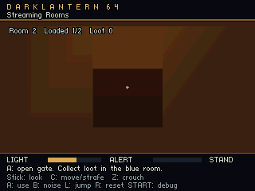
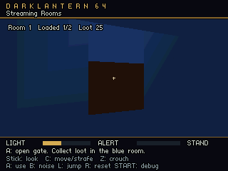

# Two-region playable streaming probe

This original scene exercises the first ROM streaming bridge with a selectable
`streaming-probe` menu entry. Its architecture and collision come from DLM1
chunks. Shared door/loot/guard visuals and compact gameplay definitions remain
resident. It is an experimental integration test, not a runnable full Bafford
mission or an accepted 8 MiB/30 fps hardware result.

Build the ordinary menu ROM and select **Streaming Rooms**:

```powershell
python tools/build.py --bundle content/level_bundle.json --run
```

Use the configured controller mappings. C-Up/C-Down move, C-Left/C-Right strafe,
the stick turns/looks, A interacts, Z crouches, and B makes a noise. Z+Start opens
the level menu. Approach the door and press A to open or close it, collect the
east-side loot, walk far enough into each side to retire the
other side, and repeatedly return. The collected loot and door state should
survive reloads; resident guards resume from their retained state.

The diagnostic build selects the same menu entry through the launcher and drives
normal game inputs. It approaches and opens the door, crosses, closes it,
collects the east loot, retires the west, backtracks, retires the east, and returns
to verify that the loot stays collected. It does not teleport along that route.

```powershell
python tools/verify_streaming_probe.py
```

The verifier builds a `--stream-test` bundle ROM, checks its recorded hash and
current probe/compiler identity, then runs an isolated 8 MiB Ares instance. It
uses the existing smoke runner's disposable settings and log directory; it does
not alter the user's active Ares profile or receive their controller input. Set
`ARES_EXE` and `N64_INST`, or pass `--ares` and `--sdk`, when those tools are
installed outside their normal locations. `--timeout` defaults to 90 seconds.

The ordinary diagnostic requires the original **Lanterns Below** cue to consume
sample frames with zero reported music underruns. Framebuffer exports run in a
separate diagnostic because exporting hundreds of log rows interrupts ordinary
frame/audio service:

```powershell
python tools/verify_streaming_probe.py --capture --output build/streaming-probe-capture-verification.json
```

This uses `--stream-test --stream-test-capture`. It decodes two real 320 × 240
framebuffers into `build/streaming-probe-west.png` and
`build/streaming-probe-east.png`, and reports functional traversal separately
from music continuity. Capture timing is diagnostic.

To analyze an already recorded run, provide its ROM and log:

```powershell
python tools/verify_streaming_probe.py --rom build/<diagnostic-name>/<diagnostic-name>.z64 --log .dev/ares/runs/<run-id>/streaming-probe.log
```

The tool writes `build/streaming-probe-verification.json`, including ROM/source
hashes, the log hash, traversal checkpoints, audio service count, load/retirement
counts, music continuity and slot byte telemetry. `--output` selects another
report path. A failed
or incomplete run produces `passed: false` and an error.

`DL64 stream_probe` JSON checkpoints record player position, door state,
collected-object mask/value and persistent guard state alongside the working
set. The completion marker must report successful assertions, input-only mode,
guard persistence and serviced audio. The verifier rejects missing completion,
counter regressions, missing current-region residency, slot growth, over-budget
chunk reservations and loot that resets or duplicates after reloading.

The first guard scheduling policy uses the existing sixteen bounded enemy slots.
`dl_game_set_active_enemies` selects detailed movement, sensing and foot-contact
work without resetting global guard state. Inactive guards can receive a
distance-only sound wake signal without querying unavailable geometry; this can
wake a listener through walls. Local acoustic propagation and coarse distant
patrol scheduling remain later work. The probe's quiet guard makes the ordinary
backtracking route deterministic; host gameplay tests separately cover inactive
sound wake and resumed simulation.

Run the targeted host checks independently:

```powershell
python -m unittest discover -s tests -p test_verify_streaming_probe.py -v
python -c "from tools.build import run_portable_tests; run_portable_tests()"
node tools/check_region_lifetime.mjs --c --proof
```

The slot telemetry counts region payload buffers and reservations. It excludes
the renderer's copied scene banks, shared meshes, global gameplay state,
directory/metadata, audio, code and display/depth allocations. Complete hardware
acceptance still needs a whole-game high-water ledger, frame-time distributions,
graphics waits, event/audio latency and underruns on original N64 and M64.

The 2026-10-13 UTC Ares run passed the ordinary route: 1,082 input ticks, four region
loads, two retirements, retained loot value 25 and collected mask 4, and unchanged
guard state after unload/reload. The original cue consumed 580,032 sample frames
with zero reported music underruns; 465 audio callbacks ran. Slots allocated
9,344 payload bytes, with 9,308 peak reserved bytes. The mission package contains
9,888 bytes, including a 568-byte directory and 192 static triangles across the
two rooms. The
[recorded evidence](evidence/streaming-probe-ares.json) identifies the tested ROM,
build signature, current source/compiler identity and log hashes.

The separate bundle lifecycle smoke passed menu idle, the 4 MiB boot gate,
authored test starts, three launch/restart cycles for all 21 variants, paused
menu resume, and direct starts. Its six heap samples for each streamed start
were stable: 955,008 bytes for default/west and 977,096 bytes for east. The
evidence includes those arrays and the final tested ROM/log hashes. Reproduce
that check with `python tools/smoke_bundle.py`; these samples demonstrate stable
restarts within the test, not a complete mission memory budget.

The separate framebuffer run passed the same functional assertions and recorded
two music underruns during its capture diagnostic. Those results are retained
separately and do not count as the ordinary audio continuity result. The west
view shows the closed doorway. The east view turns toward the same closed gate
after collecting the loot and retiring the west; its retained seam walls and
gate remain visible with only the east region resident.




