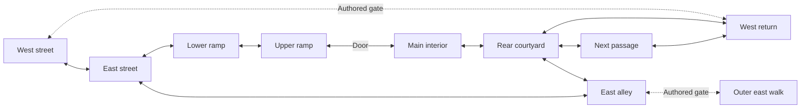
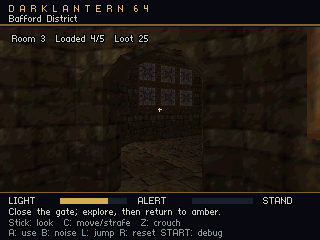
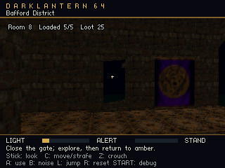
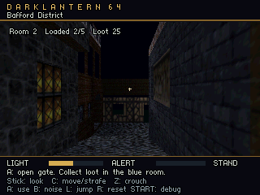

# Bafford district derivation

The local **Bafford District** source is a separate playable-content candidate,
not a conversion of the complete original mission. It keeps the 41 source cells
and evaluated artist geometry from `thief_bafford_expanded.json`, then adds 160
connected source cells around the central entrance, upper room, rear courtyard,
western rooms, next passage, eastern ramp and outer walk. Source cell 4353 has
portals but no annotated solid triangles; it remains explicit closure metadata.
There are 201 source cells, ten runtime regions and 2,537 static triangles after
the central ramp is clipped at world Z=43. This is about 4.3 times the previous
593-triangle expansion.

Commercial source JSON, meshes, textures, annotations, topology and the derived
district files remain local and ignored. The tracked derivation script, original
synthetic tests and this document contain no commercial geometry. The original
full study, edited entry, two-region stream and expanded street sources remain
unchanged. Derivation does not silently absorb subsequent edits to those sources
or overwrite subsequent district edits.

## Regions and budgets

`content/thief_bafford_district.json` uses the `streamed-mission` authoring
profile. `content/thief_bafford_district.mission.json` assigns every canonical
entity one home, separate geometry and activation bounds, directed transitions,
and an explicit authored working set. The mission has 843 source entities,
50 materials, 602 box proxies, 118 exact floor triangles, and 104 region/material
groups overall. Original geometry above the walking storey is retained, including
roofs, ceilings and source boxes.

The box counts below are static source proxies: 602 in total. The authored
central door adds one box in ramp-upper, giving 603 cooked collider records;
the working-set contact figures include that door whenever its home is resident.

| Region | Static triangles | Boxes | Exact floors | Material groups | DLR1 v4 chunk bytes |
|---|---:|---:|---:|---:|---:|
| West street | 398 | 90 | 8 | 19 | 54,736 |
| East street | 195 | 73 | 0 | 12 | 27,788 |
| Ramp lower | 73 | 20 | 10 | 5 | 10,616 |
| Ramp upper | 189 | 47 | 6 | 6 | 26,312 |
| Main interior | 222 | 24 | 26 | 5 | 30,472 |
| Rear courtyard | 248 | 39 | 16 | 4 | 33,936 |
| Next passage | 248 | 57 | 6 | 3 | 34,184 |
| West return | 206 | 61 | 2 | 13 | 28,824 |
| Lower east alley | 383 | 118 | 16 | 19 | 54,128 |
| Outer east walk | 375 | 73 | 28 | 18 | 51,952 |

The current DLR1 v4 package is 367,272 bytes, with a 14,288-byte directory and
entity table. Its largest chunk is 54,736 bytes. Five allocated region slots
therefore occupy 273,680 bytes; directory storage is separate, as are DMA
scratch, scene banks, query indexes and renderer resources. These current
storage figures come from the district entry in
`build/DarkLantern64-bundle-level_bundle-menu-district-perf-t3d/catalog/generated/bundle_report.json`.
V4 adds two states of front/back RGBA without changing source geometry or the
working-set capacities. The earlier v3 package recorded in the historical
evidence below was 245,496 bytes.
The ROM bridge checked 49 stable, chosen-transition and partial publication
states. Its current largest witnesses are:

| Budget | Actual maximum | Runtime cap | Witness |
|---|---:|---:|---|
| Static triangles | 1,322 | 1,440 | Main interior, next passage, courtyard, west street, west return |
| Boxes + floors + gates | 383 | 400 | East street, east alley, main interior, next passage, courtyard |
| Exact floor triangles | 64 | 128 | East street, east alley, main interior, next passage, courtyard |
| Region/material groups | 50 | 64 | Both streets, east alley |
| Resident region descriptors | 5 | 5 | Central entrance or courtyard/west-return transition |

The complete district exceeds the triangle, contact, group and slot budgets of
one working view. Running it therefore requires loading and retiring regions;
increasing total source capacity alone cannot make it resident. These figures
describe cooked records and compiler validation. Renderer memory, audio,
framebuffers, cache costs and target frame rate require the separate runtime
ledger and target evidence.

## Source and collision fidelity

The script evaluates the current expanded source before deriving any new parts.
It preserves the existing materials, UVs, normals, box proxies, lights, spawn and
test starts. Imported faces use per-triangle annotations from the current full
study. Triangle counts, annotated cell membership, source convex cell planes,
boundary planes and polygon fan continuity are checked against the captured
meshes. Raw Thief coordinates are converted through the existing importer
transform; arbitrary edited meshes cannot simply inherit stale annotations.

New geometry is grouped by region and material in immutable, content-addressed,
region-local OBJ files. A canonical entity anchor reconstructs world coordinates.
The central source cell 4356 spans both ramp stages, so static triangles,
axis-aligned proxies and exact floor fans are clipped at Z=43; UVs and normals
are interpolated at the cut. Bounds include a 0.0001-metre allowance for OBJ and
target-float round trips. No actor-height filter removes rendered architecture.

Box compaction performs exact same-material-semantic containment or interval
unions with matching cross sections. It does not fill gaps, change heights,
approximate nonrectangular solids with their bounds, merge distinct physical
materials or reinterpret rotated proxies. Every resulting proxy retains compound
source provenance. Box proxies crossing the ramp cut must be upright.

Upward fan triangles omitted by the original rectangle-only proxy importer are
added as exact floor contacts in the selected ground/interior storey (all triangle
vertices at world Y <= 2 metres). A triangle wholly supported by an existing flat
box is omitted from this additional floor set. This supplies the real central and
east ramp planes and the complete nonrectangular floor footprints in the main
room and courtyard. Their heights and boundaries remain those of the evaluated
source. Original diagonal or nonrectangular wall faces lacking box collision are
still an explicit limitation; the converter does not invent filled wall bounds.

## Routes, starts and authored objects

The central route leaves the starting street through source cells
4983 → 4360 → 4356 → 4355/4354 → 4981 → 4351 → 4336 → 4335 →
4334/4333 → main room 4979. The ramp is continuous; the final original stair
heights require two ordinary jumps with the current step limit. The west room
exit leads through 4281/4280 into broad space 4267, then into the next passage
through 4265/4146/4144/4143/4126, or into the west branch through 4266/4213.

A second entrance leaves the east street through 4366 → 4980 → 4323 → 4255.
Its exact 0.25-grade floor planes connect street height -2.4384 to interior height
0 without invented steps. The playable tour can backtrack through the central
entrance, return to the street, and use this separate eastern entrance. The northern passage also opens directly into the west rooms; the courtyard
connects to the rear of the eastern alley. A continuous flat route through that
alley to the separate eastern entrance has not been established, and the broad
outer-walk closure is not claimed as a proven continuous traversal route.

The original spawn and east-street/bridge-west starts remain. New menu starts
are Upper room `[0,0,35.3]`, Rear courtyard `[-2.25,0,29.845]`, East alley room
`[5,0,35.548]`, West return `[-5,0,26.33]`, and Outer east walk `[10,0,28.2]`.
All starts passed full canonical box/floor/body placement validation before
publication. A start check proves supported placement, not complete route
traversability or target acceptance.

Two primitive gameplay objects are clearly labeled **DarkLantern authored
district demonstration** in source provenance: `district-demonstration-door`
at the central arch, world center `[0,1.05,39.32]`, and value-25
`district-demonstration-loot` at `[0,0.7,34.6]`. The door belongs to ramp-upper;
both directed ramp-upper/main-interior gates reference its canonical ID. The
loot belongs to main-interior and has no opaque collider. They provide a bounded
interaction and retirement/reload persistence case. They are not imported
original Thief objects, objectives or scripts. Original mission actor placements
and logic remain omitted.

## Visibility and transitions

The policy is authored from source spatial context, with conservative working
sets around the central arch and ramp. The lower stage retains both street
regions; the upper stage retains the east street for the source window pocket.
The transition union can retain both streets, both ramp stages and the main room
without exceeding the bounded runtime. The rear, west and east branches use
their own smaller stable sets. Activation bounds and doorway blocker volumes are
separate from the truthful geometry bounds.

The next passage is mandatory in the courtyard's stable set. At the courtyard
capture position `[-2.25,0,29.87]`, looking north toward `[-1.2,23.9]`, an exact
cooked-triangle audit of 3,280 sampled rays attributed 73% of the view to next
passage geometry. Relying only on the nearest transition prefetched the west
branch while leaving that visible northern architecture absent. Adding the
passage requires a five-region courtyard/west-return union of 1,322 static
triangles and 335 contacts (271 boxes, 58 floors, six unavailable-gate barriers).
The complete source-exit audit also adds next-passage/west-room gates and two
courtyard/east-alley overlap cuts. Their five-region union requires 383 contacts
(311 boxes, 64 exact floors, eight barriers). The banks allow 1,440 triangles and
400 combined contacts for these measured closure requirements. The visibility correction preserves source geometry, exact contact footprints
and the capture angle; gate bounds follow the separate aperture audit.

This is not a source-PVS rebuild or a visibility proof. The source portal graph
checks provenance connectivity only. Runtime back views, visible closures,
single pending-gate hysteresis and collision barriers need explicit target
acceptance. Any portal, wall, door, floor or authored geometry edit requires
rechecking these sets and gates, not merely recooking unchanged metadata.

## Reproduction and safe authoring

For hand edits to rooms, openings and their visible region sets, use the
[content authoring guide](bafford-content-authoring.md). It distinguishes the
current editor controls from mesh cuts and new region rows that need external
editing.

With the ignored local sources and import evidence present:

```powershell
python tools/derive_bafford_district.py
$env:PYTHONPATH = "tests"
python -m unittest tests.test_derive_bafford_district tests.test_convert_bafford_stream tests.test_expand_bafford_stream
```

The first command refuses existing district source or partition files. Use
`--replace` only when intentionally replacing derived artist edits; it saves
recovery copies under the project editor state before atomically publishing the
new pair. All input source, manifest, annotation, topology, OBJ, texture and
discovered compiler dependencies are captured. Evaluation runs against a closed
content overlay. The transaction compares every captured input byte again at
publication, so a concurrent source or asset edit rejects the candidate.

The staged candidate must pass `prepare_stream_level` before any source, OBJ,
partition or report is published. That validates canonical authoring, home
coverage, exact floor geometry, actor starts, authored policy and the actual ROM
working-set budget. The full local report is in
`build/bafford-district-conversion/report.json`; it includes source/dependency
hashes, complete cell membership, region bounds, omission details and budget
witnesses. The level editor remains the supported authoring route for the paired
canonical source and mission partition; external region derivation is the first
import operation, not a replacement for artist edits.

Current source SHA-256:
`16160232d3051ba95ca0d78fa66bf02522399aa06659199a3c0285c2832fdcbe`.
Partition SHA-256:
`2f6aeeb0911aaf4806d8a848f0609c2552621a659df66fb5e78b1125fbd329d0`.
Historical DLR1 v3 package SHA-256 (the evidence below):
`bb709d76895198bbccf36f9febf52990f2691e0ae67ed4c28e1aa9df7c14aaf5`.
Current v4 package identities are recorded per build in its bundle report;
compiler and lighting implementation changes can change that identity while
the canonical source and partition remain unchanged.

## Playable ROM and historical route verification

Build `python tools/build.py --bundle content/level_bundle.json`, then select
**Bafford District** from the main menu. The existing **Bafford Expanded Street**
entry remains available for comparison. The default start begins on the original
street. **Upper room**, **Rear courtyard**, **East alley room**, **West return**
and **Outer east walk** give immediate access to the added spaces; the two
original street starts remain too.



Solid links were traversed in the historical input-only emulator tour. Dashed links describe
authored adjacency; complete continuous traversal of those branches remains
unproven. The central entrance follows the real sloping floor and requires two
ordinary **L** jumps over the original tall steps. **A** opens the authored
demonstration door and collects the value-25 loot in the main interior. The tour
continues into the courtyard, crosses into the rear eastern alley and back,
walks through the northern passage directly into the western rooms, then backtracks
through the central entrance and uses the separate eastern entrance.

The historical DLR1 v3 8 MiB Ares tour visited nine regions, loaded 27 chunks and retired 25
before a normal **R** restart from the eastern interior. It checked floor/body
coverage throughout, two rising jumps, door opening and closing, actual loot-home
retirement/reload, preserved collection state and clean source-spawn restart.
All 41 checkpoints' resident resources and every published view were compared
with the actual cooked working-set witnesses. Ordinary assigned music had zero
underruns. The tenth region's named start was checked through the menu lifecycle.

The historical menu test checked all 31 bundled start variants through 186 launches/restarts
and 93 resumes. Every variant reached stable per-start heaps after warmup and
matched its authored position, view, stance and initial mission state. Ordinary
menu boot, 4 MiB rejection and both direct-start modes passed. The earlier
streaming probe and expanded street also passed their input-only regressions.

The historical [integration ledger](evidence/bafford-district-integration.json) records that
normal ROM, source, partition and package identities, bounded resources,
measured heap use and remaining unknown memory categories. Separate
[ordinary-tour](evidence/bafford-district-ordinary.json),
[capture](evidence/bafford-district-capture.json) and
[menu](evidence/bafford-district-menu.json) records retain their own tested ROM
and log identities. Framebuffer export is a diagnostic with extra audio cost;
its underruns do not represent the ordinary tour.

Historical framebuffer views from that capture ROM:

| Main interior | Rear courtyard | Eastern interior |
|---|---|---|
|  |  |  |

## Historical editor and exchange verification

The actual 843-entity district was edited in an isolated live editor copy.
Six checks covered activation/working-set paired Undo/Redo, directed gate edits,
door deletion and reference repair with Undo, floor-only Drop to surface,
floor-vertex source history and rendered collision edges, and paired Save + Cook
against the final source identities. Publication remained ROM-valid and Native
Play stayed explicitly gated. See [editor evidence](evidence/bafford-district-editor.json)
and the [streaming editor contract](streaming-editor.md).

Exact floor triangles are authorable through **Add floor triangle**, local
Inspector vertices and transformed collision overlays. A real Blender checkout
and export checked unchanged rotated/scaled round trips, parent placement,
vertex edits and rejection of lost parents. See
[Blender evidence](evidence/bafford-district-blender.json). Blender remains an
exchange route; the canonical source and partition remain the editor document.

The final source-boundary audit samples supported standing placements on both
sides of every directed gate at 0.02-metre lateral intervals. It found and fixed
gaps at the ramp split, main arch and rear passages. Gates now cover the real
openings, including off-center crossings; geometry is unchanged. The audit and
its sampling limits are in [gate evidence](evidence/bafford-district-gates.json).
Portable swept-transition checks cover thin gates, delayed readiness, activation
overlap, reversal and reset. Source and target-floor preflight also reject
float-rounding cases that would lose valid support at runtime.

## Practical limits and next work

The earlier evidence accepted a larger playable streaming/content experiment.
That v3 implementation synchronously prepared renderer resources and static
lighting, producing long room-loading pauses recorded in its historical ledger.
The current v4 implementation cooks static night lighting offline, stages and
reuses renderer resources, and builds bounded collision query indexes. Its
gameplay-frame, simulation and gate-wait acceptance is recorded separately in
[the performance workflow](bafford-stream-performance.md). The final continuous
Ares tour passes all of those checks, including zero gate waits and music
underruns. The [current integration ledger](evidence/stream-performance-integration.json)
also records the matching normal/menu ROM, ordinary and capture tours, older
streaming regressions and editor checks. Original-hardware performance remains
unverified.

At that historical checkpoint, the broad Python suite ran 450 tests: 447 passed, two were skipped, and the
existing local Sponza geometry/collider mismatch
(`sponza-collision-parapet-north`) still failed. Final focused compiler, derivation
and verifier checks passed, including 14 final derivation checks with thick
landing support, as did all portable C groups, the real editor build
and its native floor packet/drawing test. These checks address different parts
of the pipeline; the ledger separates their scope.

Original mission guards, scripts and objectives, general triangle wall collision,
complete source PVS, original N64/M64 validation and the unproven route closures
remain ahead. Region create/rename/delete controls and stream Native Play are
also pending. Structural wall/floor/gate edits require fresh visibility,
aperture, collision and working-set checks; a successful recook alone does not
prove those content properties.
