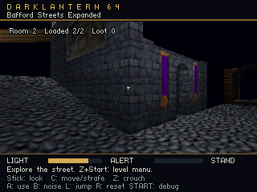
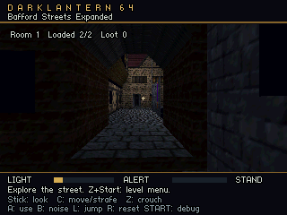

# Bafford Streets Expanded

`tools/expand_bafford_stream.py` preserves the evaluated, edited entry and adds
four connected cells from the local full source study. It produces a separate
editable scene and mission manifest; the full study, original entry and first
stream conversion remain untouched. Commercial geometry/textures and their
derived JSON/OBJ remain ignored local content.

Generate the local entry, full study and source annotations with the
[Thief importer](thief-bafford-study.md#reproduce-and-edit) before running the
expander on a fresh checkout. Existing artist inputs remain authoritative.

```powershell
python tools/expand_bafford_stream.py
python tools/build.py --bundle content/level_bundle.json --run
```

Choose **Bafford Streets Expanded** from the main menu. The default start
retains the original spawn; **East street** and **Bridge west** are available
as named starts. Use **L** to jump onto the raised crossing.

Default outputs are `content/thief_bafford_expanded.json`,
`content/thief_bafford_expanded.mission.json`, content-addressed local OBJ parts,
and `build/bafford-expanded-conversion/report.json`. `--cells` can select a
different connected set of new source IDs; ordinary playable scene validation
and the existing two-region capacities still apply. The tool never makes the
full `external-scale-study` cookable. It reads only static meshes needed by the
selected full-study cells.

Existing expanded JSON/manifest are protected by an overwrite gate. Explicit
`--replace` retains their previous bytes under
`.dev/editor/replaced-expansions/<transaction>/`. Subsequent artist edits to
the expanded scene are independent work and must not be silently regenerated
by editor Save. The original source filenames cannot be replacement targets.

## Chosen route and its cost

The original 37 source cells remain, including all current authored entry
geometry, spawn, environment and 16 lights. The new cells are:

| Source cell | Added triangles | Purpose |
| --- | ---: | --- |
| 4366 | 46 | East street beyond the former corridor endpoint |
| 3831 | 12 | Raised bridge section |
| 4987 | 34 | Street beyond the bridge |
| 4360 | 14 | South ground threshold, without a manor access claim |

The portal path from the original start is
`4984 -> 4388 -> 4983 -> 4366 -> 3831 -> 4987`. The new east endpoint
`[15.1, -2.4384, 48.5]` extends travel from the original x=-6.522049 to
roughly 21.6 metres, compared with the earlier 8.7-metre route. This is a
meaningful increase in traversable coverage rather than a claim that the
entire geometry footprint doubled.

Cell 3831's floor is 0.3048 metres above the street, exceeding the current
0.28-metre step allowance. The ordinary jump mechanic is needed in each
direction. Authored presets `east-street` at `[14.8,-2.4384,48.5]` and
`bridge-west` at `[9.3,-2.1336,48.5]` aid editor/ROM inspection. The original
spawn and facing are retained. Source route/free-volume checks are separate
from target-ROM acceptance and performance evidence.

The resulting scene has 581 evaluated source triangles, 593 after the seam,
163 collision boxes, 211 home entities, 23 materials and 31 nonempty
region/material groups. It fits the existing 1,024-triangle, 256-box,
256-entity and 64-group budgets without a new whole-mission profile.

| Cooked metric | West | East |
| --- | ---: | ---: |
| Triangles | 398 | 195 |
| Collision boxes | 90 | 73 |
| Region/material groups | 19 | 12 |
| Home entities | 116 | 95 |
| Chunk bytes | 35,296 | 18,428 |

Actual `prepare_stream_level` validation succeeds. The DLM package is
57,312 bytes with a 3,576-byte directory, SHA-256
`7c5ede76463ce57b07dd2e37531a868b37b77634b1c5dd33b66c41c14b6df700`.
Shared decoded textures use 47,104 bytes, excluding sprite/allocator/renderer
overhead. Both exterior regions remain resident under `all-regions` visibility.
Source portal connectivity does not prove PVS or safe region retirement.

The unfiltered first portal ring would contain 71 cells, 922 triangles and
350 rectangular proxies. Exact union merging can fit its collision budget
near 256, but its additional proxy entities, 37 mesh groups and markers exceed
the ordinary 256-entity source profile. It also adds many vertical pockets
without extending the useful ground route as far. The chosen route retains
space for source development within the existing caps.

## Exact collision compaction

The expansion reconstructs new collision proxies from the selected source
polygons using the existing `polygon_box` rule: only axis-aligned rectangular
faces become thin boxes, thickened away from the walkable cell. Filtering the
full import's first-owner proxy list would be unreliable when a globally
deduplicated shared face belongs to a cell outside the selection. Current
entry proxies are evaluated directly from their authored transforms.

The merger reduces 201 original proxies to 158 before the region seam creates
five additional pieces. It accepts only containment or overlapping/touching
intervals with exactly equal extents along the other two axes. Physical
`surface` and `tags` meanings must match. It uses no endpoint tolerance,
coordinate snapping, hull approximation or gap filling. Arbitrarily rotated
boxes remain individual proxies and the ordinary seam converter rejects a
rotated box crossing the plane.

Every merged box records all original scene/entity IDs, material metadata,
transforms and collider definitions. Its derived ID binds its exact bounds
and sorted source IDs. Scene entity compaction happens before package cooking,
so the gain applies to canonical home IDs as well as runtime collision arrays.
The original visual triangles and materials remain separate from proxy
compaction.

## Captured input and topology checks

The entry, full JSON, triangle annotations, source topology and all read
dependencies are captured and hashed. Source entry validation is repeated
against a closed content snapshot. New meshes and textures are also read from
that snapshot. Publication checks every original input byte under the project
transaction lock; concurrent edits cause a retry. All outputs are staged and
ordinary publication failures roll back through the shared project transaction.

The new full-study triangle count must match its annotation array. Each cell
ID must agree with the source entity, every selected triangle must remain
inside its annotated convex cell and on a boundary plane, and each polygon's
triangle fan must remain continuous before a rectangular proxy is rebuilt.
The geometric tolerance is 0.0001 source units, approximately 0.00003048
metres, to account for importer/OBJ precision. Changed annotation counts or
geometry outside those constraints are rejected explicitly.

New triangle provenance retains the original full entity/model/triangle index
and cell/polygon IDs. Old entry geometry is evaluated from the current entry,
never replaced by corresponding full-study surfaces. Existing entry material
edits win when material IDs are shared with added surfaces.

These checks establish a bounded source-cell selection, not a rebuilt portal
graph after arbitrary editing. Cell/polygon IDs remain provenance. Future
visibility, navigation, lighting and region retirement must be recompiled from
edited geometry, as required by [streaming-editor.md](streaming-editor.md).

## Editor and remaining scope

The mission-backed project catalog opens the expanded canonical scene. Its
manifest owns home assignments, bounds, neighbors and conservative visibility;
the editor shows source/ROM capacity diagnostics and launches the mapped
`bafford-expanded` bundle entry. The viewport is a complete authoring preview.
Native Play remains blocked until it shares the portable stream runtime.
Added objects or geometry moved beyond its home bounds need visible assignment
and bounds repairs, not automatic regeneration from commercial source.

The new cells omit collision for four sloped and five nonrectangular/thin
polygons, matching the original importer policy. Original entry omissions
persist. No guards, loot, usable source doors or original mission scripts are
introduced. The manor, roofs, swimming, ladders and full source world remain
outside this conversion's acceptance.

Synthetic tests cover exact-union preservation, tiny gaps/slab differences,
material separation, deterministic merging, old source preservation,
triangle provenance, topology rejection, overwritten artist edits, concurrent
mesh/topology changes and publication rollback:

```powershell
python -m unittest discover -s tests -p test_expand_bafford_stream.py -v
```

## Actual ROM traversal and captures

The ordinary Ares diagnostic selected `bafford-expanded` through the launcher
menu, walked from the preserved source spawn to the east street and returned
west using game inputs. It crossed the raised bridge with exactly two ordinary
jump inputs. The existing 0.28-metre step allowance was unchanged. Fifteen
checkpoints recorded a `west -> east -> west` region route, ending at tick
1,507. The east endpoint reached `[15.0028,-2.4384,48.5]`, beyond the previous
street coverage's x=8.382 limit. Supported bridge landings retained the source
floor y=-2.1336; lower street checkpoints retained y=-2.4384. Both bridge
crossings recorded rising airborne motion before their supported landings.

The diagnostic checked current-region coverage, ordinary body clearance and
the bounded height/support conditions during every route tick. The log parser
checks waypoint order, fixed 60 Hz simulation time, ordinary movement speed,
airborne rises and landings, and unchanged allocations. These are checks
against the final cooked collision bank; the exploratory source-route audit
is supplemental planning information, not original free-volume acceptance.

All fifteen ordinary checkpoint heaps were 1,319,952 bytes, including five
samples after reaching the extended east street. The final working scene had
31 models, 163 colliders and 23 textures. The parser binds these counts to
the recorded cooked region material groups, collider counts and packed texture
list. Two loads read/reserved 53,724 payload bytes into 70,592 allocated slot
bytes, with zero retirements under the conservative exterior policy. Music
consumed 805,176 frames and generated 637 blocks, with zero underruns across
26 telemetry samples; 731 normal audio callbacks were serviced.

Fully resident stream telemetry also matched the package's 593 triangles.
The verifier requires that record and the exact fixed-slot allocation derived
from the largest aligned cooked region. Twenty-three parser regression tests
pass, including uniformly falsified resource counts and inflated slot sizes.

The separate capture build passed the same physical route and exported two
actual 320x240 framebuffers. Its checkpoint heap was 1,319,944 bytes and its
blocking framebuffer exports produced three music underruns. Its timing and
audio results remain separate from ordinary traversal acceptance. The first
view shows the preserved western street; the second looks west from the new
eastern endpoint through the raised passage after a turn made with input.





[Recorded Ares evidence](evidence/thief-bafford-expanded-ares.json) binds both
immutable ROM snapshots, build metadata, source/cook/package hashes, raw log
hashes, strict parser reanalyses and image hashes. Ordinary ROM SHA-256 is
`8db465550e9adf70ac8293f71cd2b3d642b2f11cfbe24cfb577668fbf2441fa0`;
capture ROM SHA-256 is
`c782c2c9870fcbe973c9cac9bf5dff320304e45bb7c0ea75002bbc22b5956929`.
[Integration evidence](evidence/thief-bafford-expanded-integration.json)
records menu/preset/restart lifecycle, editor preparation and the original
room/flat-street regressions separately.

The complete menu lifecycle passed all 23 default/named starts through three
launch/restart/resume cycles. Each of the three expanded Bafford starts had
six heap samples of 1,311,712 bytes. These lifecycle samples use a different
initialization path from the walking diagnostic. The ordinary menu remained
idle until selection; the 4 MiB boot guard and both bundle/standalone direct
starts also passed. The original room probe retained its loot and guard state
through four loads and two retirements, with zero music underruns. The
previous flat Bafford route also passed unchanged, including strict reanalysis
of its frozen ROM/log and zero music underruns.

The project editor rebuilt and passed 12 live checks, including paired history,
source-only Undo, region controls, evaluated bounds fitting, stale-file Save
rejection, paired Save, invalid coverage handling, both deletion paths and
rendered valid/malformed partition repair. Its 38 backend tests completed with
one Windows symlink privilege skip. The 23 diagnostic parser tests, 13 expansion
tests, 11 original converter tests, 25 mission tests, 20 bundle tests and all
portable C checks passed. Broader Python discovery ran 404 tests with two skips
and only the previously established Sponza parapet geometry/collision mismatch.

```powershell
python tools/verify_bafford_expanded.py --ares C:/Users/hughe/AppData/Local/ares/ares.exe
python tools/verify_bafford_expanded.py --capture --output build/bafford-expanded-capture-verification.json --ares C:/Users/hughe/AppData/Local/ares/ares.exe
python -m unittest tests.test_verify_bafford_stream tests.test_verify_bafford_expanded
```

Run emulator diagnostics sequentially. `--rom` reuses a diagnostic ROM;
`--log` analyzes its recorded run only when given the matching immutable ROM
snapshot and adjacent `verification-build.json`. These Ares measurements do
not establish original N64/M64 performance, whole-RAM savings, safe exterior
retirement or full-manor gameplay.
