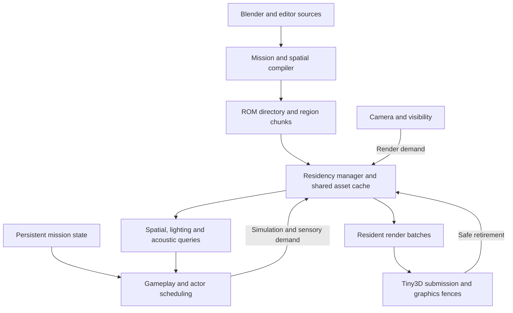

# Bafford runtime implementation architecture

Prepared 2026-10-12. This implements the direction in
[the runtime plan](thief-bafford-runtime-plan.md). The full source study remains
protected from normal Play and ROM cooking. Passing a host package or loader
test is not acceptance of the complete mission on N64/M64.

## Working-set contract

One residency service coordinates the resources needed by rendering, movement,
navigation, lighting, acoustics and actor simulation. Persistent gameplay state
survives for the entire mission; region resources are bounded and replaceable.

| Lifetime | Owned data |
| --- | --- |
| Mission | Stable entity IDs; all compact guard states; doors, collected loot, objectives and inventory; delayed events; coarse region/nav/acoustic graph |
| Resident region | Geometry, static collision BVH, detailed navigation and visibility, light/probe data, local resource references |
| Active presentation/frame | Draw lists, actor animation, matrices, mutable vertex/color data and graphics ownership pins |

Use portable C17 tables and explicit services. Region installation binds global
IDs to existing mission state; it never calls game initialization. Generation
handles prevent a recycled slot from satisfying an old resource reference.



## Compiler and package

Introduce an explicit versioned, endian-defined, pointer-free mission format.
The directory contains region bounds, coarse connectivity, ROM offsets,
decoded sizes and global IDs. Independently loadable region chunks contain
geometry, collision, navigation, visibility and lighting. Shared textures,
character meshes and animations are asset-cache resources identified by hash.
Native structs, opaque RSP command blocks and host pointers are never stored.

Keep source IDs and a numeric debug mapping in reports. Numeric IDs are dense
within a cooked mission. Persistent save compatibility across different cooks
requires a later explicit policy; deterministic sorting alone does not provide
that compatibility.

Partition by cooked byte cost, likely simultaneous visibility and traversable
boundaries, with authoring overrides. Source cells and current mesh grid bins
are inputs, not load regions. The small resident coarse graph chooses demand;
fine portal/BSP data can itself be streamed. Compiler reports must account for
every retained surface/entity, omitted behavior and worst tested overlap.

The first [package contract](mission-package-format.md) intentionally uses
uncompressed portable static triangles and existing upright collider boxes.
It establishes separate directory/chunk storage and decoder agreement before
Tiny3D packing, texture resources, richer collision or full mission gameplay.

## Residency and ownership

The manager reserves a caller-provided buffer before reading. Requested chunks
advance through reading and validation before publication. IO and CRC work are
bounded per pump; installation has a defined ownership boundary. Partial or
invalid chunks cannot be borrowed. The initial reader callback retains no
transfer ownership after return; a real asynchronous DMA adapter must track
in-flight DMA and acknowledge cancellation only after its destination is safe.

Demand is the union of camera visibility, swept movement, guard activity,
navigation and sensory query dependencies. Collision/nav must be ready before
entry. Prefetch follows velocity, measured load latency, open sightlines,
pursuits and backtracking; hysteresis avoids repeated churn. A late required
load stops traversal at a safe boundary and uses a defined loading presentation.

Retirement stops new CPU borrows. Existing borrowers may finish and submit
graphics work. Reuse waits for CPU pins and independent RSP/RDP completion.
An RSP vertex/matrix syncpoint is insufficient to free an RDP-referenced
texture. Shared mesh ownership belongs to the cache rather than a first
instance that may independently unload.

All slot capacities remain allocated while their manager exists. Reports must
distinguish allocated capacity, reserved chunk extent and published bytes.
Freeing a slot does not return its capacity to the heap.

## Spatial and rendering services

Use static per-region triangle BVHs plus dynamic doors/trapdoors as the baseline
collision representation. Expose sweeps, support contacts, traces and walkable
queries with HIT/CLEAR/UNAVAILABLE outcomes. Missing data must never mean empty
space. Active sensory queries require complete dependency coverage rather than
silently treating unavailable geometry as clear or dark.

Support contacts carry normal, material and stable surface identity. Compile
navigation from actual walkable geometry and standing/crouching clearance,
with explicit cross-region, door and vertical traversal links. Original portal
connectivity does not establish actor traversability.

Begin visibility with conservative region sets, then refine loaded candidates
through portal traversal and frustum tests before renderer preparation. Reached
cells must preserve the union of views through different portals. Uncertain
topology expands selection; if the fallback exceeds the envelope, report the
problem rather than hide visible rooms.

Cook static architecture into tightly bounded, region-local Tiny3D batches.
Retain one immutable packed stream where possible; buffer mutable actor data
and local lighting patches separately. Current CPU fog rewrites vertex colors,
so immutable static batches need a suitable graphics fog path or bounded
visible-geometry scratch during migration. Preserve quantized seam positions,
UV spans and thin openings after actual target packing.

## Persistent gameplay, light and sound

Retain all guard positions, awareness, targets, deadlines and patrol progress in
mission-owned state. Nearby, alerted and perceptually relevant actors receive
detailed updates. Quiet distant actors use scheduled coarse navigation while
honoring live doors and waking before crossings. Sounds and pursuits wake
actors independently of rendering. Keep simulation ticks separate from the
30 fps mission rendering target; schedule sensing separately from motion.

A door has a cooked dependency record for collision, visibility, navigation,
acoustics and influenced light receivers, including neighbors. Preflight the
change, update authoritative state and local revisions, and apply current state
when an unloaded region activates. Bake static light and recompute locally
state-sensitive contributions against actual door combinations. Independently
adding per-door shadow deltas is unsafe when doors jointly occlude a source.

Player visibility and actor illumination share current source/probe semantics;
exposure and fog are presentation only. Physical sounds carry stable emitter
IDs, time, surface/gait and strength. Hearing and playback consume the same
event independently. Acoustic edges have door-transmission rules separate from
visual portals, and delayed events remain mission-owned.

## Authoring integration

Export evaluated geometry plus an explicit provenance/topology sidecar. Source
IDs seed the compiler; edited geometry is authoritative. Hash geometry,
transforms, collision flags, materials, portals, lights and compiler settings.
UV-only edits need not rebuild navigation. Structural edits rebuild affected
regions plus neighboring seam/visibility/light dependencies. Unclassified edits
require a conservative rebuild or diagnosed fallback.

Water, ladders and trapdoors must have implemented mechanics or explicit
playable substitutes recorded in the adapted mission definition. Retain a route
audit and intentional differences from the source mission.

## Delivery gates

1. Establish package/decoder agreement and a whole-game memory ledger. Cook an
   original two-region probe without generated C geometry.
2. Integrate a platform loader and renderer for those regions, adding a shared
   texture, mutable door, collectible and pursuing guard. Repeated crossings,
   delayed IO, immediate reversal and graphics/audio overlap must preserve
   resources, collision coverage and mission state.
3. Establish richer collision, visibility, nav, local lighting/acoustics and
   edited-geometry rebuilding before growing region coverage.
4. Complete adapted routes and objective flow; accept busy views and transitions
   on emulator, original N64 and M64 with hashes, frame distributions, load
   stalls, peak memory and audio underruns recorded.

The governing budget is worst simultaneous overlap, including retired graphics
resources, decoder scratch, retained audio capacity and explicit reserve. All
legacy bundled C arrays remain part of the startup ledger until migrated.
Region sizes and concurrency limits follow measurements, not total mission
counts or an assumed free remainder of RDRAM.

## Initial branch scope

The first implementation adds a manual-partition mission cooker, bounded
pointer-free directory/chunk readers, and a portable region lifetime manager.
Host tests exercise malformed packages, IO stalls, bounded read work, failed
publication, independent graphics fences, cancellation and slot reuse. A finite
lifecycle model checks the abstract ownership protocol; its evidence must state
the boundary between host interpreter semantics and the separately tested C
implementation.

This foundation does not yet replace `DlLevel`, render streamed chunks on the
console, supply triangle sweeps/nav/PVS, or make Bafford playable. Those remain
the next delivery gates above, rather than hidden omissions in an accepted
mission format.

### Reproduce the foundation

```powershell
python tools/compile_mission.py --manifest content/streaming_probe.mission.json --output build/streaming_probe.dlm
python -m unittest discover -s tests -p test_compile_mission.py -v
python -c "from tools.build import run_portable_tests; run_portable_tests()"
python tools/build.py --bundle content/level_bundle.json
```

The portable checks compile the decoder/manager with the host C17 compiler and
load the independently cooked probe with bounded file reads. The two-region
fixture has seven entity IDs, 24 static triangles and three upright colliders.
Its package is 1,728 bytes, directory 312 bytes, and total region payloads 1,404
bytes. The single-slot repeated-load test allocates 720 payload bytes and
crosses the region sequence both ways for four cycles. These figures exclude
slot metadata and every rendering, gameplay, audio and display allocation.
They demonstrate the storage/ownership contract, not player traversal.

See [lifecycle verification](models/README.md) for the optional pinned TLA
PreCheck tool and `node tools/check_region_lifetime.mjs --c --proof`.
Its two-slot model explored 3,136 states and 17,024 edges; normalized C trace
conformance checked 148 transitions and 1,250 observed steps. The checked-in
evidence explicitly does not claim automatic C equivalence or hardware timing.

On 2026-10-12, all 15 mission cook tests and all portable C checks passed. The
existing Tiny3D game bundle also compiled/linked/packaged with the new portable
sources. The broad Python run executed 332 tests with two skips and one error
in `test_sponza_physics`: authored Sponza parapet proxies differ from the
reference geometry. Comparing the unchanged files/functions at base commit
`adb70f1b9702203adee294ff22152712b2bcafd5` reproduced that mismatch. This branch
does not change those scene/reference inputs. Sandbox temporary-file rename
restrictions required placing test scratch in the workspace; MSYS's Windows
shared-object requirements required an unsandboxed N64 build invocation.
