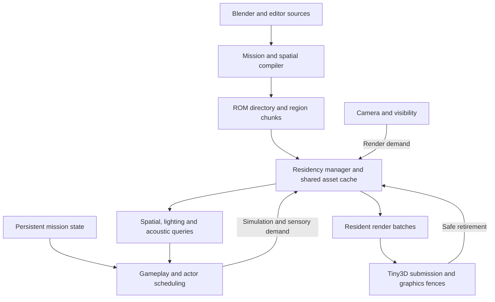

# Bafford runtime implementation architecture

Prepared 2026-10-12. This implements the direction in
[the runtime plan](thief-bafford-runtime-plan.md). The full source study remains
protected from normal Play and ROM cooking. Passing a host package or loader
test is not acceptance of the complete mission on N64/M64.

## Working-set contract

One residency service coordinates the resources needed by rendering, movement,
navigation, lighting, acoustics and actor simulation. Persistent gameplay state
survives for the entire mission; region resources are bounded and replaceable.

| Lifetime | Owned data |
| --- | --- |
| Mission | Stable entity IDs; all compact guard states; doors, collected loot, objectives and inventory; delayed events; coarse region/nav/acoustic graph |
| Resident region | Geometry, static collision BVH, detailed navigation and visibility, light/probe data, local resource references |
| Active presentation/frame | Draw lists, actor animation, matrices, mutable vertex/color data and graphics ownership pins |

Use portable C17 tables and explicit services. Region installation binds global
IDs to existing mission state; it never calls game initialization. Generation
handles prevent a recycled slot from satisfying an old resource reference.



## Compiler and package

Introduce an explicit versioned, endian-defined, pointer-free mission format.
The directory contains region bounds, coarse connectivity, ROM offsets,
decoded sizes and global IDs. Independently loadable region chunks contain
geometry, collision, navigation, visibility and lighting. Shared textures,
character meshes and animations are asset-cache resources identified by hash.
Native structs, opaque RSP command blocks and host pointers are never stored.

Keep source IDs and a numeric debug mapping in reports. Numeric IDs are dense
within a cooked mission. Persistent save compatibility across different cooks
requires a later explicit policy; deterministic sorting alone does not provide
that compatibility.

Partition by cooked byte cost, likely simultaneous visibility and traversable
boundaries, with authoring overrides. Source cells and current mesh grid bins
are inputs, not load regions. The small resident coarse graph chooses demand;
fine portal/BSP data can itself be streamed. Compiler reports must account for
every retained surface/entity, omitted behavior and worst tested overlap.

The first [package contract](mission-package-format.md) intentionally uses
uncompressed portable static triangles and existing upright collider boxes.
It establishes separate directory/chunk storage and decoder agreement before
Tiny3D packing, texture resources, richer collision or full mission gameplay.

## Residency and ownership

The manager reserves a caller-provided buffer before reading. Requested chunks
advance through reading and validation before publication. IO and CRC work are
bounded per pump; installation has a defined ownership boundary. Partial or
invalid chunks cannot be borrowed. The initial reader callback retains no
transfer ownership after return; a real asynchronous DMA adapter must track
in-flight DMA and acknowledge cancellation only after its destination is safe.

Demand is the union of camera visibility, swept movement, guard activity,
navigation and sensory query dependencies. Collision/nav must be ready before
entry. Prefetch follows velocity, measured load latency, open sightlines,
pursuits and backtracking; hysteresis avoids repeated churn. A late required
load stops traversal at a safe boundary and uses a defined loading presentation.

Retirement stops new CPU borrows. Existing borrowers may finish and submit
graphics work. Reuse waits for CPU pins and independent RSP/RDP completion.
An RSP vertex/matrix syncpoint is insufficient to free an RDP-referenced
texture. Shared mesh ownership belongs to the cache rather than a first
instance that may independently unload.

All slot capacities remain allocated while their manager exists. Reports must
distinguish allocated capacity, reserved chunk extent and published bytes.
Freeing a slot does not return its capacity to the heap.

## Spatial and rendering services

Use static per-region triangle BVHs plus dynamic doors/trapdoors as the baseline
collision representation. Expose sweeps, support contacts, traces and walkable
queries with HIT/CLEAR/UNAVAILABLE outcomes. Missing data must never mean empty
space. Active sensory queries require complete dependency coverage rather than
silently treating unavailable geometry as clear or dark.

Support contacts carry normal, material and stable surface identity. Compile
navigation from actual walkable geometry and standing/crouching clearance,
with explicit cross-region, door and vertical traversal links. Original portal
connectivity does not establish actor traversability.

Begin visibility with conservative region sets, then refine loaded candidates
through portal traversal and frustum tests before renderer preparation. Reached
cells must preserve the union of views through different portals. Uncertain
topology expands selection; if the fallback exceeds the envelope, report the
problem rather than hide visible rooms.

Cook static architecture into tightly bounded, region-local Tiny3D batches.
Retain one immutable packed stream where possible; buffer mutable actor data
and local lighting patches separately. Current CPU fog rewrites vertex colors,
so immutable static batches need a suitable graphics fog path or bounded
visible-geometry scratch during migration. Preserve quantized seam positions,
UV spans and thin openings after actual target packing.

## Persistent gameplay, light and sound

Retain all guard positions, awareness, targets, deadlines and patrol progress in
mission-owned state. Nearby, alerted and perceptually relevant actors receive
detailed updates. Quiet distant actors use scheduled coarse navigation while
honoring live doors and waking before crossings. Sounds and pursuits wake
actors independently of rendering. Keep simulation ticks separate from the
30 fps mission rendering target; schedule sensing separately from motion.

A door has a cooked dependency record for collision, visibility, navigation,
acoustics and influenced light receivers, including neighbors. Preflight the
change, update authoritative state and local revisions, and apply current state
when an unloaded region activates. Bake static light and recompute locally
state-sensitive contributions against actual door combinations. Independently
adding per-door shadow deltas is unsafe when doors jointly occlude a source.

Player visibility and actor illumination share current source/probe semantics;
exposure and fog are presentation only. Physical sounds carry stable emitter
IDs, time, surface/gait and strength. Hearing and playback consume the same
event independently. Acoustic edges have door-transmission rules separate from
visual portals, and delayed events remain mission-owned.

## Authoring integration

The level editor owns the production workflow. A Blender scene can prove the
geometry import, but content authors must be able to create regions, assign
stable entity homes, edit boundaries and doors, inspect derived spatial data,
and play the same package from the editor. Source scene and region manifest
form one document for save, undo and publication. Preparation must invalidate
affected regions and seams and explain unresolved assignments at the object.
Native Play must use the portable loader and persistent mission state, with
delayed reads and unavailable collision handled as on ROM. See
[streaming editor integration](streaming-editor.md) for the current bridge and
the required authoring, diagnostics, transaction and preview acceptance gates.

Export evaluated geometry plus an explicit provenance/topology sidecar. Source
IDs seed the compiler; edited geometry is authoritative. Hash geometry,
transforms, collision flags, materials, portals, lights and compiler settings.
UV-only edits need not rebuild navigation. Structural edits rebuild affected
regions plus neighboring seam/visibility/light dependencies. Unclassified edits
require a conservative rebuild or diagnosed fallback.

Water, ladders and trapdoors must have implemented mechanics or explicit
playable substitutes recorded in the adapted mission definition. Retain a route
audit and intentional differences from the source mission.

## Delivery gates

1. Establish package/decoder agreement and a whole-game memory ledger. Cook an
   original two-region probe without generated C geometry.
2. Integrate a platform loader and renderer for those regions, adding a shared
   texture, mutable door, collectible and pursuing guard. Repeated crossings,
   delayed IO, immediate reversal and graphics/audio overlap must preserve
   resources, collision coverage and mission state.
3. Establish richer collision, visibility, nav, local lighting/acoustics and
   edited-geometry rebuilding before growing region coverage.
4. Complete adapted routes and objective flow; accept busy views and transitions
   on emulator, original N64 and M64 with hashes, frame distributions, load
   stalls, peak memory and audio underruns recorded.

The governing budget is worst simultaneous overlap, including retired graphics
resources, decoder scratch, retained audio capacity and explicit reserve. All
legacy bundled C arrays remain part of the startup ledger until migrated.
Region sizes and concurrency limits follow measurements, not total mission
counts or an assumed free remainder of RDRAM.

## Initial foundation (commit 5942349)

The first implementation added a manual-partition mission cooker, bounded
pointer-free directory/chunk readers, and a portable region lifetime manager.
Host tests exercise malformed packages, IO stalls, bounded read work, failed
publication, independent graphics fences, cancellation and slot reuse. A finite
lifecycle model checks the abstract ownership protocol; its evidence must state
the boundary between host interpreter semantics and the separately tested C
implementation.

That foundation did not replace `DlLevel`, render streamed chunks on the
console, supply triangle sweeps/nav/PVS, or make Bafford playable. Those remain
the next delivery gates above, rather than hidden omissions in an accepted
mission format.

### Reproduce the foundation

```powershell
python tools/compile_mission.py --manifest content/streaming_probe.mission.json --output build/streaming_probe.dlm
python -m unittest discover -s tests -p test_compile_mission.py -v
python -c "from tools.build import run_portable_tests; run_portable_tests()"
python tools/build.py --bundle content/level_bundle.json
```

The portable checks compile the decoder/manager with the host C17 compiler and
load the independently cooked probe with bounded file reads. The initial
two-region fixture had seven entity IDs, 24 static triangles and three upright
colliders. Its package was 1,728 bytes, directory 312 bytes, and region payloads 1,404
bytes. The initial single-slot repeated-load test allocated 720 payload bytes
and crossed the region sequence both ways for four cycles. These figures exclude
slot metadata and every rendering, gameplay, audio and display allocation.
They demonstrate the storage/ownership contract, not player traversal.

See [lifecycle verification](models/README.md) for the optional pinned TLA
PreCheck tool and `node tools/check_region_lifetime.mjs --c --proof`.
Its two-slot model explored 3,136 states and 17,024 edges; normalized C trace
conformance checked 148 transitions and 1,250 observed steps. The checked-in
evidence explicitly does not claim automatic C equivalence or hardware timing.

On 2026-10-12, all 15 mission cook tests and all portable C checks passed. The
existing Tiny3D game bundle also compiled/linked/packaged with the new portable
sources. The broad Python run executed 332 tests with two skips and one error
in `test_sponza_physics`: authored Sponza parapet proxies differ from the
reference geometry. Comparing the unchanged files/functions at base commit
`adb70f1b9702203adee294ff22152712b2bcafd5` reproduced that mismatch. This branch
does not change those scene/reference inputs. Sandbox temporary-file rename
restrictions required placing test scratch in the workspace; MSYS's Windows
shared-object requirements required an unsandboxed N64 build invocation.

## Playable ROM bridge and editor integration

The next increment adds **Streaming Rooms** to the ordinary game menu. The
expanded original probe has twenty-three entity IDs, 192 static triangles and
seventeen colliders. Its 9,888-byte mission package contains a 568-byte directory
and 9,308 bytes of region payloads. Only three dynamic visuals and compact
gameplay definitions are emitted into the bootstrap header; architecture and
static collision come from region chunks. Each room owns its boundary wall
faces so retiring its peer preserves enclosure; the small shared door visual
stays resident. General cross-boundary dependency compilation remains later work.

The ROM adapter uses two fixed payload slots and asynchronous PI reads into
aligned scratch. It validates directory and chunk records before publication.
Closed-door distance controls prefetch/retirement, while opening the connecting
door demands both rooms; this is a probe policy pending general portal/PVS
scheduling. Collision barriers cover unavailable regions, and a door use can
wait for the adjoining region. Alerted guards retain their current region.
ROM cooking and the editor diagnose this adapter's two-region and bounded
rendering contract before launch; the portable package cooker remains broader.
Foreground music service yields while PI reads are outstanding; audio callbacks
continue consuming buffered PCM. RSP syncpoints and RDP completion callbacks
are distinct retirement fences.

The portable scene bridge copies validated resident geometry and colliders
into one of two bounded banks. A working-set change releases the existing
renderer before publishing the new bank and rebuilding its caches. This
transitional implementation introduces a graphics wait and rebuild cost; the
target per-region immutable Tiny3D packets remain future work. It does not
retain pointers into chunk payloads. Global loot, doors, objectives and guard
state survive bank changes without reinitializing the game. Inactive guards
retain state and receive a coarse distance-only sound wake signal; distant
patrol simulation and acoustic propagation remain unimplemented.

The editor now preserves the manifest through catalog, duplicate, delete and
menu operations, shows partition and byte diagnostics, and launches the
streamed bundle. Its authoring viewport shows the full scene. Region controls
and stream Native Play are still required before this can support routine
content development; Native Play is explicitly disabled for these missions.

See [playable probe and verification](streaming-probe.md) for the current
input-driven Ares evidence, reproduction commands and screenshots. Region
payload allocation stays at 9,344 bytes; the complete memory ledger must also
account for both scene banks, renderer copies, shared assets, persistent state,
audio, display and legacy bundled arrays. This increment does not establish
full Bafford playability, arbitrary mission scale, target frame times or
original N64/M64 acceptance.

On 2026-10-12 the targeted mission and bundle tests passed, as did
all portable C checks. Editor project tests passed with one Windows symlink
privilege skip. The full Python suite ran 357 tests with two skips and the same
pre-existing Sponza parapet collision mismatch described above; it had no
streaming or editor failures. The ordinary input-driven Ares traversal had
zero reported music underruns. The complete bundle lifecycle smoke also passed,
including three launch/restart/resume cycles for each streamed preset with
exactly stable per-phase heap samples.

## Textured Bafford entry conversion

The conversion branch derives two regions from the edited, playable Bafford
entry source while leaving that source and the full manor study unchanged.
Evaluated triangles and box proxies are clipped at an authored street seam.
Canonical region-local OBJ assets retain interpolated UVs, normals and source
entity/triangle provenance. Original dependencies are captured for preparation
and checked again before transactional publication. Existing derived edits
require an explicit replacement, with recovery copies retained.

DLR1 chunk version 2 extends each triangle to 80 bytes with UVs and signed
normal attributes; the DLM1 directory remains version 1, and original 44-byte
triangles remain supported. Shared texture sprites use the existing texture
cooker and active-level renderer lifetime. They are not yet evicted by region.
The bounded scene bridge now permits 1,024 static triangles and 64 draw groups,
with the existing 256-collider working bank and a 64 KiB per-chunk limit.
Cooking and editor diagnostics enforce these limits before ROM publication.

The source entry's 475 triangles and 155 proxies become 487 triangles and 158
proxies after seam clipping, grouped into 28 region/material groups. Its
48,512-byte package includes a 3,448-byte directory. No architecture or
collider arrays remain in the streamed bootstrap; the menu replaces the legacy
resident entry. Both chunks remain loaded because the street has open
sightlines. Distance-based retirement would hide visible buildings. This
demonstrates textured chunk loading and traversal, not a reduced working set
for the full manor. See [Bafford streaming conversion](thief-bafford-streaming.md)
for reproducible generation, editor handling and measured verification.
