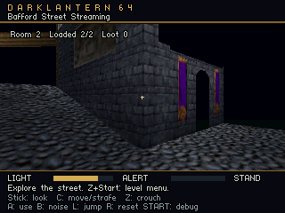
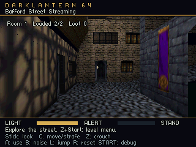

# Bafford street streaming conversion

**Bafford Street Streaming** is a playable conversion of the locally imported
starting street. It replaces the legacy `bafford-entry` game-menu entry with
`bafford-stream`. The complete manor remains an authoring study. Original source
scenes and Blender checkouts remain available for comparison and editing.

The converter derives `content/thief_bafford_stream.json` and its partition
manifest from the edited `thief_bafford_entry.json`. It clips geometry and box
collision at X = -3.048 m, interpolates UVs/normals, and assigns every derived
entity a region home. The 475 source triangles and 155 boxes become 487 triangles
and 158 boxes after splitting. There are 20 terrain materials, 28 region/material
groups and 16 retained light snapshots. Source cells/polygons remain provenance;
this operation does not rebuild their portals, BSP or navigation.

The DLM1 package uses DLR1 version 2 triangles to retain UVs and normals. The
active level's 20 packed RGBA16 textures occupy 40,960 pixel bytes, excluding
sprite headers and renderer allocations. Terrain and collision are read from
the two ROM chunks; the bootstrap contains zero meshes, models or colliders.
The normal bundle excludes the previous resident Bafford entry arrays.

This street has no proven visibility separator, so `visibility: all-regions`
keeps both regions resident. Crossing changes the player's region without
retiring visible architecture. The separate [two-room probe](streaming-probe.md)
continues to test eviction/reload and persistent gameplay state. This conversion
does not establish full-mission memory savings or texture streaming.

Generate the source locally, then derive the stream scene:

```powershell
python tools/import_thief.py --install "C:\Program Files (x86)\Steam\steamapps\common\thief_gold"
python tools/convert_bafford_stream.py
python tools/project_levels.py cook --level thief_bafford_stream.json
python tools/build.py --bundle content/level_bundle.json --run
```

Use the importer only when the original local source has not already been
created. The converter refuses to replace an existing derived scene without
`--replace`; explicit replacement preserves recovery copies of the scene and
manifest. Commercial geometry, textures and generated scenes remain ignored by
Git. The conversion report is `build/bafford-stream-conversion/report.json`.

Select **Bafford Street Streaming** from the game menu. The default position and
135° facing retain the imported start. C-Up/C-Down move, C-Left/C-Right strafe,
the stick turns/looks, Z crouches, and Z+Start opens the level menu. For the
verified flat route, turn into the east/west street and stay near Z = 49.4 m,
between X = -6.52 m and X = 2.2 m. Feet remain at Y = -2.4384 m. Some other
source surfaces still lack collision proxies or lead into omitted cells.

Open the derived canonical scene in the editor, inspect its Streaming panel,
and use **Run level in Ares**. This resolves the mission bundle entry. The full
authoring viewport remains available; Native Play is still gated for stream
missions as described in [the editor workflow](streaming-editor.md).

The diagnostic selects this same menu entry and uses ordinary turning/walking
inputs to cross east, return west, and cross east again:

```powershell
python tools/verify_bafford_stream.py --ares C:/Users/hughe/AppData/Local/ares/ares.exe
python -m unittest discover -s tests -p test_verify_bafford_stream.py -v
```

It verifies ROM/build hashes, current source/compiler identity, chunk version,
textures and bootstrap layout. It checks launch/checkpoint/completion ordering,
60 Hz input time, walking speed, waypoint arrival, source floor height, body
clearance and region coverage. Both regions must remain resident with exactly
two loads, no retirements and fixed slot/payload bytes. Repeated crossings must
keep the same heap samples after the first traversal. The assigned original
**Lanterns Below** cue must consume sample frames with zero reported underruns.
Reports are written to `build/bafford-stream-verification.json`; an isolated ROM,
build snapshot and log are retained under `.dev/ares/runs/`.

The 2026-10-13 UTC ordinary Ares run passed all assertions. Its final checkpoint
was input tick 1,054, and all seven heap samples were 1,290,680 bytes. Two slots
allocated 72,608 bytes and retained 45,052 payload bytes; the package was 48,512
bytes, including a 3,448-byte directory. Music consumed 546,960 sample frames in
434 generated blocks with zero underruns; 525 audio callbacks ran. These are
emulator measurements, not a whole-game RAM ledger or original N64/M64
performance acceptance. [Evidence](evidence/thief-bafford-streaming-ares.json)
records the tested source, package, ROM, build and log hashes.

The final bundle lifecycle smoke also passed menu idle, the 4 MiB boot gate,
all 21 default/preset variants through three launch/restart cycles, paused
resume and direct starts. Bafford's default produced six identical heap samples
of 1,282,464 bytes; this initialization path differs from the walking route.
There are no named Bafford starts yet. The original two-room diagnostic still
passed four loads, two retirements, retained loot/guard state and zero music
underruns after the v2 bridge changes. The editor rebuilt and its actual project
cook reported valid portable/ROM partitions and the `bafford-stream` launch ID,
with Native Play correctly gated. Those hashes and scopes are retained in the
same evidence file.

Framebuffer exports run separately:

```powershell
python tools/verify_bafford_stream.py --capture --output build/bafford-stream-capture-verification.json --ares C:/Users/hughe/AppData/Local/ares/ares.exe
```

The capture run passed the same functional route and decoded two actual
320 × 240 framebuffers. It recorded three music underruns during export; its
timing is separate from the ordinary continuity result. The west image shows
the original starting frontage. The east image looks back along the street
after turning through ordinary controls. Both display two loaded regions.




